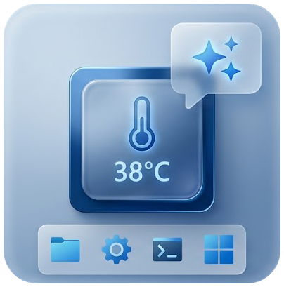
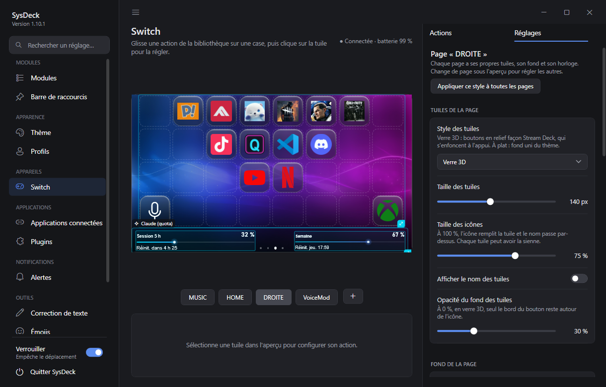
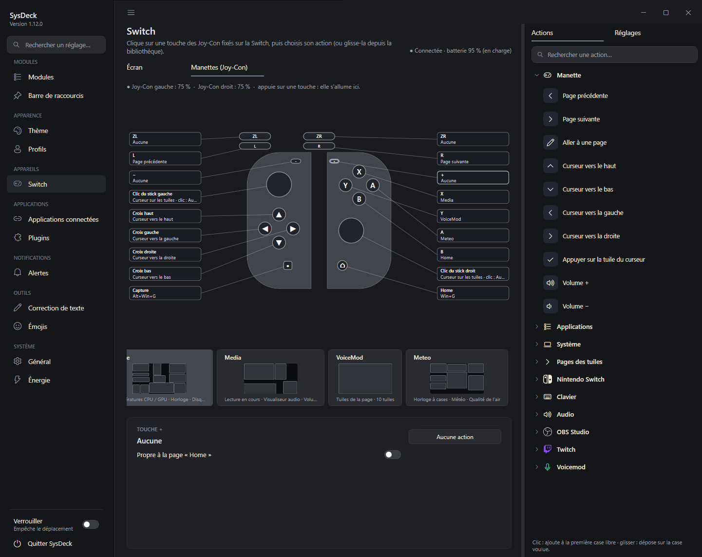
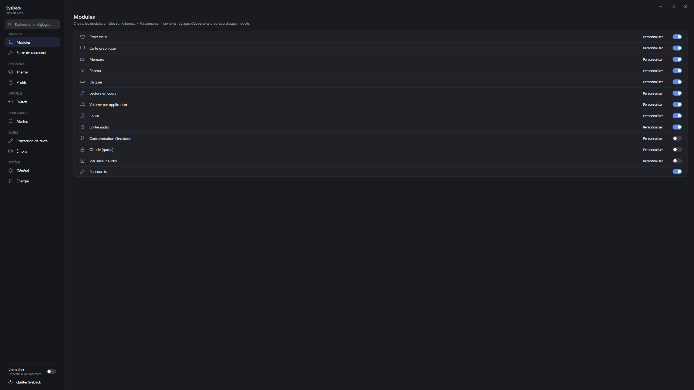
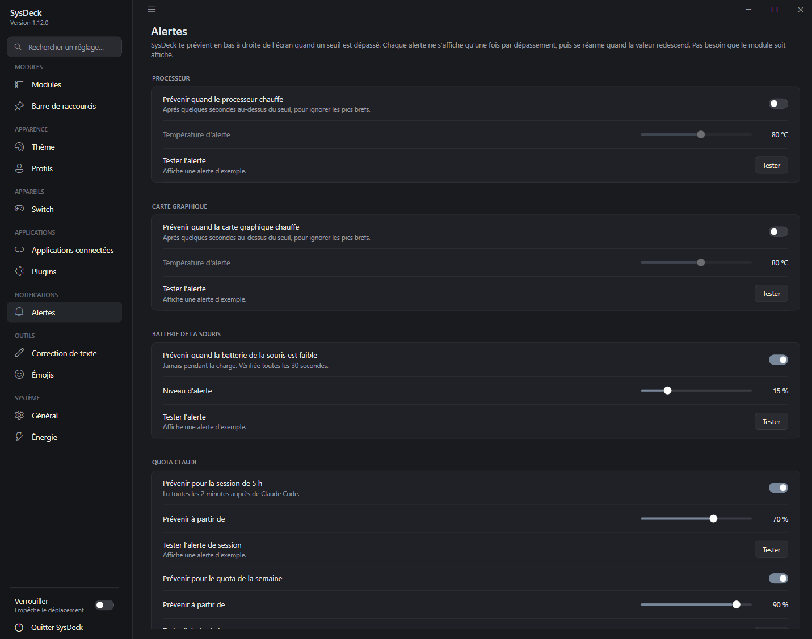
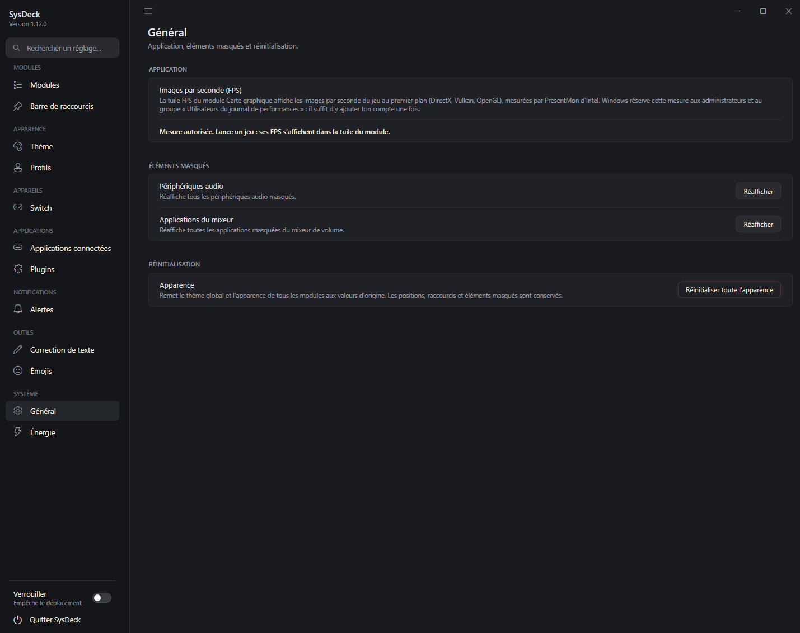
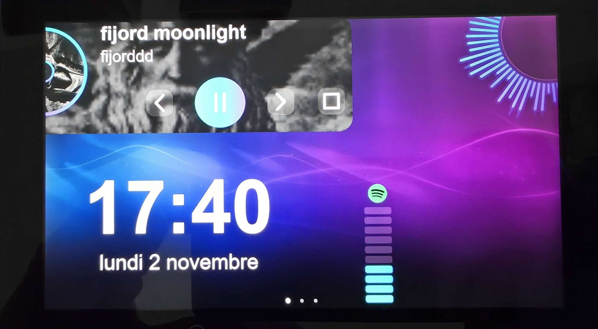
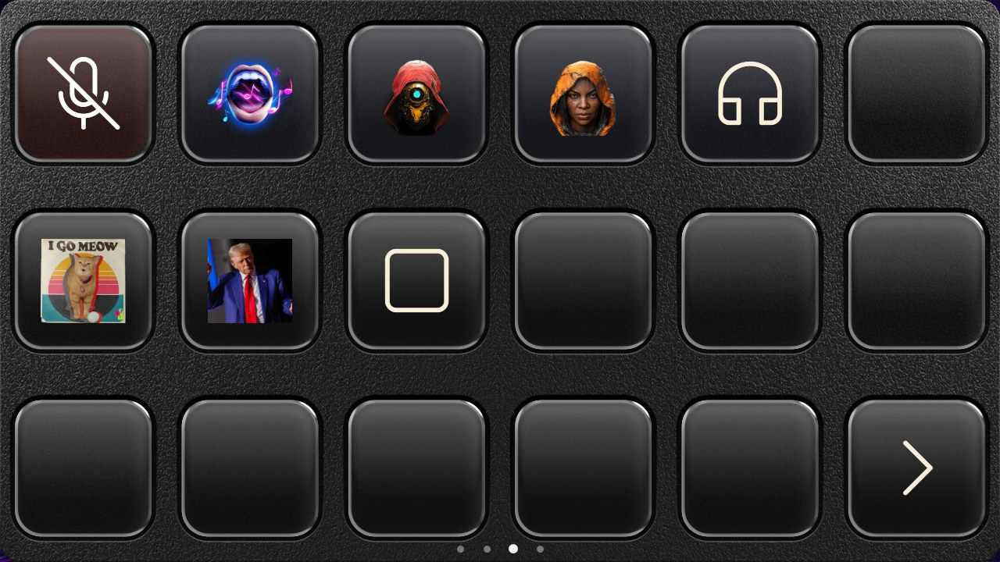

<p align="center"></p>

<h1 align="center">SysDeck</h1>

<p align="center">
Widgets de bureau pour Windows + Nintendo Switch transformée en écran tactile / stream deck USB.<br>
<a href="README.md">English</a> · <b>Français</b>
</p>

---

SysDeck (WPF, .NET 8) affiche des widgets rattachés au bureau (sous les fenêtres, comme les icônes) :
surveillance du matériel, audio, lecture en cours, horloges, calendrier, météo, consommation électrique en euros,
barre de raccourcis, quota Claude et correction de texte par IA. Tout est personnalisable depuis les Paramètres.

Avec le **payload SwitchDeck**, une Nintendo Switch branchée en USB-C devient un second écran tactile
1280×720 : le PC dessine les modules et les tuiles, la Switch les affiche et renvoie le tactile.
Les tuiles, en **boutons de verre 3D** façon Stream Deck, pilotent aussi **OBS Studio**, **Twitch** et **Voicemod**,
et des **plugins** : ceux de SysDeck et les plugins **Stream Deck d'Elgato** open source, à installer depuis un catalogue GitHub.
Les Joy-Con fixés sur la Switch peuvent aussi lancer des actions de SysDeck.

## Aperçu

<table>
  <tr>
    <td width="30%" valign="top"><br><sub>Widgets sur le bureau</sub></td>
    <td valign="top"><br><sub>La Switch branchée en USB-C : matériel, horloge et sortie audio en direct</sub></td>
  </tr>
</table>

<details>
<summary><b>Plus de captures</b></summary>

| | |
|---|---|
| <br><sub>Page Switch : aperçu en direct, pages, inspecteur de tuile et éditeur d'icône</sub> | <br><sub>Clic sur un widget de l'aperçu : tous ses réglages Switch en dessous</sub> |
| <br><sub>Vue Joy-Con : une action par touche, propre à une page si besoin</sub> | <br><sub>Choix des modules</sub> |
| <br><sub>Personnalisation d'un module : aperçu cliquable, carte, jauges, animations</sub> | <br><sub>Applications connectées : OBS Studio, Twitch, Voicemod</sub> |
| <br><sub>Alertes : température CPU et GPU, batterie de la souris, quota Claude</sub> | <br><sub>Général : mesure des FPS, éléments masqués, réinitialisation</sub> |

</details>

## Sommaire

- [Modules](#modules)
- [Compatibilité](#compatibilité)
- [Module Switch (SwitchDeck)](#module-switch-switchdeck)
- [Applications connectées (stream deck)](#applications-connectées-stream-deck)
- [Mode console](#mode-console)
- [Compiler](#compiler)
- [Organisation du dépôt](#organisation-du-dépôt)
- [Données](#données)
- [Dépannage](#dépannage)
- [Licences et crédits](#licences-et-crédits)

## Modules

| Id | Module | Source des données |
|---|---|---|
| `cpu`, `gpu`, `ram` | Processeur, carte graphique, mémoire | LibreHardwareMonitor (+ `Tools/CpuTempBridge.ps1` pour la température AMD) |
| `network` | Débit réseau | Compteurs des interfaces réseau |
| `disk` | Disques | `DriveInfo` |
| `media` | Lecture en cours : 4 dispositions, barre de temps, aléatoire/répétition | API Windows.Media.Control (Spotify, navigateurs, VLC…) |
| `volumemixer` | Volume par application | Core Audio (NAudio) |
| `audio` | Sortie audio | Core Audio + IPolicyConfig |
| `mouse` | Batterie souris Logitech | HID++ 2.0 (HidSharp) |
| `power` | Consommation en € | Puissance GPU mesurée, CPU estimé, journal Windows pour le passé |
| `claude` | Quota d'utilisation Claude | Jeton de Claude Code (lu seulement) |
| `visualizer` | Visualiseur audio | Capture de la sortie audio (NAudio) |
| `tileclock` | Horloge à cases colorées (HH:MM:SS) | Horloge du système |
| `analogclock` | Horloge ronde à aiguilles avec la date | Horloge du système |
| `calendar` | Calendrier du mois | Horloge du système |
| `weather` | Météo et prévisions sur 4 jours | [Open-Meteo](https://open-meteo.com) (gratuit, sans compte) |
| `moon` | Phases de la Lune : vraie photo de la Lune ombrée selon la phase, nom de la phase, éclairement, prochaines phases | Calcul sans connexion (termes de Meeus, à quelques heures près) |
| `sun` | Lever et coucher du soleil : course du soleil, heures, durée du jour, prochain événement | Open-Meteo, même ville que la météo |
| `airquality` | Qualité de l'air (indice européen, PM2.5, PM10, NO₂, O₃) | Open-Meteo, même ville que la météo |
| `temperatures` | Courbes de température CPU et GPU sur un même graphe | LibreHardwareMonitor |
| `sensorbars` | Barres pour n'importe quel capteur (températures, charges, RAM, VRAM, ventilateurs…) | LibreHardwareMonitor |
| `simhub` | Course automobile : rapport, vitesse, régime, temps au tour, position, carburant | [SimHub](https://www.simhubdash.com) + le plugin [SimHub Property Server](https://github.com/pre-martin/SimHubPropertyServer) |
| `shortcuts` | Barre de raccourcis | `shortcuts.json` |

- **Correction IA** : sélectionner un texte dans n'importe quelle application puis **Ctrl+Espace**
  (clé API Gemini à saisir dans les Paramètres).
- **Sélecteur d'émojis** : un raccourci global (à choisir dans les Paramètres) ouvre, près du curseur, un
  sélecteur avec catégories, recherche et émojis récents ; l'émoji choisi est tapé dans l'application active.
  Les émojis servent aussi d'icônes pour les tuiles de la Switch.
- **Sur le bureau** : **clic droit** sur un module pour le personnaliser, changer sa taille ou celle des textes,
  modifier la disposition, verrouiller les positions ou le masquer ; **Ctrl+molette** pour l'agrandir ou le réduire.
- **Profils et thèmes** : enregistrement, export/import (`.sysdeckprofile`), 9 thèmes prêts à l'emploi (dont « Edge noir » :
  cartes noires mates, jauges fines, accent orange).
- **Réglages des modules** : les options des horloges, de la météo, de la qualité de l'air, des températures, des barres de
  capteurs, de SimHub et du lecteur sont dans la personnalisation du module (onglet Style). Les nouveaux modules sont
  masqués tant qu'on ne les active pas.
- **Lecture en cours** : dispositions Compact, Bannière (grande pochette), Vinyle (disque qui tourne avec la pochette en
  étiquette) ou Pochette et disque ; barre de temps fine, épaisse ou en segments (un clic avance ou recule) ; boutons
  avec ou sans fond ; aléatoire et répétition. Pochette, morceau, barre de temps et boutons se déplacent.
- **Barres de capteurs** : n'importe quelle mesure, une barre horizontale (ou verticale) chacune ; segments, pleine ou
  dégradé, couleur par barre, halo, couleur d'alerte au-delà d'un seuil.
- **Sélecteur de couleur** : le sélecteur de Windows garde maintenant ses couleurs personnalisées.
- **Alertes** : température CPU/GPU, batterie de la souris, quota Claude.

## Compatibilité

La plupart des informations fonctionnent sur n'importe quel PC Windows 10/11 sans réglage : charge du processeur,
mémoire, réseau, disques et carte graphique (NVIDIA, AMD ou Intel). Quelques exceptions :

- **Température du processeur, CPU AMD Ryzen** : installer le SDK AMD Ryzen Master, puis cocher l'option
  « Température du processeur » dans l'installateur de SysDeck.
- **Température du processeur, CPU Intel** : aucun pont n'est fourni ; la température risque de rester vide,
  sauf peut-être en lançant SysDeck en administrateur avec l'Intégrité de la mémoire désactivée (non testé).
- **Batterie de la souris** : seulement les souris Logitech compatibles HID++.
- **Ventilateurs** : ceux de la carte graphique sont lus sans réglage. Ceux de la carte mère (CPU, boîtier) demandent le
  pilote de bas niveau que l'Intégrité de la mémoire bloque ; ils n'apparaissent dans la liste des capteurs que si Windows
  le permet.

## Module Switch (SwitchDeck)

Le dossier [`payload/`](payload) contient un payload bare-metal lancé depuis
[hekate](https://github.com/CTCaer/hekate). Une fois lancé, la Switch attend SysDeck sur le port USB-C.

- Pages de modules et de tuiles (applications, liens, raccourcis clavier, commandes, son/micro muet,
  OBS Studio, Twitch, Voicemod, plugins).
- Le widget **Tuiles de la page** peut avoir ses propres sous-pages, indépendantes des pages complètes de la Switch.
  Dans l'inspecteur d'une tuile, choisir **Page du widget → Nouvelle page** pour la déplacer et créer une sous-page,
  puis ajouter les actions **Page précédente** et **Page suivante** depuis la bibliothèque pour naviguer entre elles.
  Les flèches bouclent aux extrémités. Chaque tuile flèche peut aussi recevoir un bouton Joy-Con : il commande
  cette flèche sur la page Switch où elle est mappée et retrouve son affectation Joy-Con habituelle sur les autres pages.
- Actions système Switch dans la bibliothèque de la page : éteindre et démarrer en mode RCM, ou relancer hekate
  depuis `bootloader/update.bin` ou `payload.bin` sur la carte SD. Ces actions demandent un second appui pour éviter
  un déclenchement accidentel.
- **Page Switch des Paramètres façon Stream Deck** : aperçu en direct au centre, aperçus des pages en dessous et
  panneau de droite redimensionnable pour la bibliothèque d'actions et les réglages de la tuile ou de la commande
  Joy-Con sélectionnée. Cliquer sur une action ou la glisser sur une tuile ; le menu de gauche se masque (☰ ou Ctrl+B).
- **Éditeur de disposition** : déplacer et redimensionner directement les modules et leurs éléments dans l'aperçu,
  avec grille et guides d'alignement, ou sélectionner plusieurs éléments avec Ctrl+clic pour les déplacer ou
  redimensionner ensemble. Appliquer une disposition équilibrée, jeu, monitoring ou compacte comme point de départ,
  puis l'ajuster librement. La grille de tuiles peut adapter automatiquement ses colonnes ou utiliser un nombre choisi.
- **Transitions entre les pages** : choisir aucune, glissement, fondu, glissement et fondu ou zoom, puis régler la
  durée et l'accélération.
- **Boutons en verre 3D** qui s'enfoncent à l'appui, ou tuiles à plat ; fond transparent possible. En style verre,
  les cases vides affichent des boutons vierges, comme les touches inutilisées d'un vrai Stream Deck.
- **Widget des tuiles façon Stream Deck** : fond arrondi facultatif (couleur ou texture : un grain noir est fourni et
  tu peux ajouter les tiennes), chaque bouton étant encastré dans son propre creux. La grille remplit le widget : des
  tuiles plus petites ajoutent des colonnes et des lignes (jusqu'à 16 × 9) et la place restante est répartie entre les cases.
- **Inspecteur des widgets et des tuiles** : un clic sur un widget dans l'aperçu Switch affiche juste en dessous tous
  ses réglages Switch (couleurs, carte, animations, textes, boutons, affichage ou masquage de chaque élément, taille à
  l'écran), avec un aperçu cliquable du widget. Pour une tuile : taille d'icône propre, indépendante du réglage de la
  page, et nom affiché ou masqué indépendamment des autres tuiles.
- **Chaque page a son style** : taille des tuiles et des icônes (jusqu'à remplir la tuile), verre ou plat, noms,
  fond (couleur, image), horloge. « Appliquer ce style à toutes les pages » en un clic.
- **Tuile active** (micro coupé, live en cours, scène active…) : couleur et deuxième icône au choix, bouton qui
  reste enfoncé.
- **Joy-Con** (payload v6) : les Joy-Con fixés sur la Switch (ou les commandes d'une Switch Lite) lancent des actions.
  La vue « Manettes (Joy-Con) » montre uniquement les deux manettes, dans un style neutre : clic sur une touche (ou
  action de la bibliothèque glissée dessus) pour lui donner une action de tuile, un changement de page, un curseur qui
  se promène sur les tuiles, le volume, ou l'accès direct à une page choisie (par exemple X → Home, Y → Media).
  Sticks : curseur, volume, souris ou défilement. Affectations communes à
  toutes les pages ou propres à une page. PC éteint, elles peuvent charger si la Switch reçoit une alimentation USB
  externe ; sur batterie, leur alimentation reste coupée pour préserver celle de la console.
- Les deux nouvelles actions système Switch nécessitent le payload SwitchDeck protocole v7 ou ultérieur.
- Glissement entre pages, curseurs au doigt, boutons VOL± = volume de Windows.
- **Mode nuit** : PC éteint, la Switch affiche une image et l'heure (horloge interne recalée par le PC).
- Menu (VOL+ et VOL- en attente) : éteindre, redémarrer, revenir à hekate.

| | |
|---|---|
| <br><sub>Températures, disque, réseau, RAM, CPU, GPU, Voicemod, horloge, tuiles en verre, sortie audio</sub> | <br><sub>Lecture en cours, visualiseur, Voicemod, sortie audio</sub> |
| <br><sub>Tuiles façon Stream Deck : plaque texturée, boutons en verre encastrés</sub> | <br><sub>Météo, horloge à cases, qualité de l'air, calendrier, Lune, quota Claude, barres de capteurs</sub> |

Installation : copier `payload/output/switchdeck.bin` dans `sd:/bootloader/payloads/` puis le lancer
depuis hekate (*Payloads*). Le pilote WinUSB est choisi automatiquement par Windows (descripteurs MS OS 2.0).

> Le payload s'exécute directement sur le matériel. Il ne modifie ni la NAND ni le système de la console,
> mais vous l'utilisez à vos risques.

## Applications connectées (stream deck)

Dans **Paramètres → Applications connectées**, **+ Ajouter une application** active OBS Studio, Twitch ou
Voicemod. On crée ensuite des tuiles de ce type depuis la bibliothèque d'actions de la page Switch. Les tuiles
affichent l'état en direct (scène active, live ou enregistrement en cours, mode actif, micro coupé…) et
s'atténuent quand l'application n'est pas connectée.

| Application | Connexion | Actions des tuiles |
|---|---|---|
| **OBS Studio** | Serveur WebSocket d'OBS 28+ (*Outils → Paramètres du serveur WebSocket*) : hôte, port, mot de passe | Changer de scène, stream, enregistrement et pause, caméra virtuelle, tampon de relecture et sauvegarde, couper une entrée audio, afficher/masquer une source, transition du mode Studio |
| **Twitch** | « Se connecter à Twitch » : code à valider sur twitch.tv, sans mot de passe dans SysDeck | Clip (lien copié), marqueur, message dans le chat, pub, modes du chat (lent, émotes, followers, abonnés), mode bouclier, titre, catégorie |
| **Voicemod** | Voicemod lancé sur le PC ; autoriser SysDeck dans Voicemod la première fois | Changeur de voix, charger une voix, voix au hasard, jouer un son du soundboard, arrêter les sons, micro, « M'entendre », ambiance |

- **Saisie sur la Switch** : une tuile Twitch *message*, *titre* ou *catégorie* peut demander son texte à
  l'appui. Un clavier AZERTY s'ouvre alors sur la Switch, avec les émotes Twitch du compte, les émojis et une
  recherche de catégories avec jaquettes. Depuis le bureau, une petite fenêtre de saisie s'ouvre sur le PC.
- **Voicemod** : voix et sons choisis dans les listes de Voicemod, avec leur image comme icône. Les sons
  sont classés par soundboard, les vôtres en tête.

## Mode console

Jouer aux jeux du PC sur une TV branchée en HDMI, avec une interface de salon pilotée à la manette. Réglages dans
**Paramètres → Mode console**.

- **Bascule** : les écrans du PC s'éteignent, seule la TV reste active, le son part sur la TV. Au retour, la
  disposition des écrans, les icônes du bureau, les widgets et les applications (réduites pendant le mode) reviennent
  comme avant. Après un plantage, tout est remis au démarrage suivant. Raccourci de secours : **Ctrl+Alt+Fin**.
- **Interface TV** : jaquettes, fond animé, description, temps de jeu, batterie de la manette, 10 thèmes avec aperçu
  en direct (bouton Menu ≡), intro animée de 10 s (ou vos propres images, sons et vidéos).
- **Jeux** : programme `.exe`, raccourci `.lnk` / `.url`, lien `steam://`, ou émulateur + ROM (préréglages Dolphin,
  PCSX2, DuckStation, PPSSPP, RPCS3, Cemu, Ryujinx, Eden / yuzu, Xemu, mGBA, RetroArch). Jaquettes et descriptions
  depuis Steam, ou SteamGridDB avec une clé gratuite. Le jeu s'ouvre au premier plan ; le menu revient dès qu'il se
  ferme. **Quitter** (X) ferme le jeu (fin de tâche immédiate pour un émulateur).
- **Manette Xbox** :

| Action | Boutons |
|---|---|
| Lancer le mode console depuis le PC | **View ⧉ + Menu ≡** (modifiable : LB+RB+Menu, LB+RB+View) |
| Volume (menu et jeux) | **View ⧉ + RT** / **View ⧉ + LT** |
| Naviguer, jouer, retour | Croix ou stick, **A**, **B** |
| Plateformes / thèmes / infos / quitter le jeu | **LB RB** / **Menu ≡** / **Y** / **X** |
| Revenir au menu pendant un jeu | Appui long sur le bouton Xbox |

### TV par le réseau (facultatif)

Avec une TV **Google TV / Android TV** sur le même réseau, SysDeck peut l'**allumer** en entrant en mode console, la
passer sur l'**entrée HDMI du PC**, régler son **vrai volume**, et la **mettre en veille** au retour (deux options
séparées). Section **TV et manette** : *Rechercher*, *Appairer* (un code s'affiche sur la TV), puis choisir l'entrée
HDMI du PC et *Tester*.

| TV | Allumer / éteindre | Volume de la TV | Entrée HDMI du PC |
|---|---|---|---|
| Google TV / Android TV (Sony, TCL, Hisense, Philips, Xiaomi…) | Oui (*) | Oui | Oui : *Tester*, sinon *Trouver la méthode* |
| Samsung (Tizen), LG (webOS), Philips non Android | Non | Volume Windows | Non |
| TV non connectée au réseau | Non | Volume Windows | Non |

(*) Pour l'allumage depuis la veille, activer le réveil par le réseau sur la TV : *Wake on Wireless LAN* (Wi-Fi) ou
*Wake-on-LAN* (câble), parfois *Allumer avec Chromecast*. Chaque marque change d'entrée à sa façon :
**Trouver la méthode** essaie les méthodes connues une par une (la TV revient à l'accueil entre deux essais) et
retient celle qui affiche l'entrée du PC.

**Dépannage** : la TV ne s'allume pas (réveil réseau non activé, ou TV sur un Wi-Fi « invité » isolé du PC) ; la
TV clignote quelques secondes après la bascule (un écran DisplayPort du PC se met en veille et se déconnecte :
désactiver sa veille profonde) ; un émulateur se ferme tout de suite (voir `%AppData%\SysDeck\logs\sysdeck.log`).

## Plugins et packs d'icônes

- **Plugins** : un plugin est un petit programme (exe, Node.js, Python ou PowerShell) relié à SysDeck par un
  WebSocket local. Ses actions apparaissent dans la bibliothèque de la page Switch ; il peut changer le titre,
  l'image et l'état de ses tuiles en direct.
  - **Catalogue** (Paramètres → Plugins) : recherche sur GitHub (sujets `sysdeck-plugin`, `streamdeck-plugin`),
    installation en un clic de la dernière version et mises à jour. Les plugins « Vérifiés » sont listés dans
    [plugins/catalogue.json](plugins/catalogue.json).
  - **Plugins Stream Deck d'Elgato** : les plugins open source (`.streamDeckPlugin` non chiffré, dossier
    `.sdPlugin`) fonctionnent, avec leur page de réglages affichée dans l'inspecteur (WebView2). Node.js est
    téléchargé une fois sur nodejs.org si le PC n'en a pas. Ceux du Marketplace d'Elgato sont chiffrés et ne
    fonctionnent pas ; les actions de molette (Stream Deck +) non plus.
  - Écrire un plugin : [docs/plugins.md](docs/plugins.md) et l'exemple [plugins/exemple-compteur](plugins/exemple-compteur).
- **Packs d'icônes** : dans le choix d'icône d'une tuile, **Pack d'icônes…** importe un pack au format du
  Stream Deck (`.streamDeckIconPack`, icônes SVG comprises), un zip ou un dossier d'images. Chaque pack devient
  une catégorie, avec recherche par nom et mots-clés. Une image (icône de pack monochrome) peut être recolorée.

## Compiler

### Application Windows

Prérequis : SDK .NET 8 et, pour l'installateur, [Inno Setup 6](https://jrsoftware.org/isinfo.php).

```powershell
# Développement et tests
dotnet build SysDeck.sln -c Debug
dotnet test SysDeck.sln

# Version publiée puis installateur (SysDeck\installer\output\SysDeckSetup.exe)
dotnet publish SysDeck\SysDeck.csproj -c Release -o SysDeck\bin\publish
& "$env:LOCALAPPDATA\Programs\Inno Setup 6\ISCC.exe" SysDeck\installer\SysDeck.iss
```

La version est définie dans `SysDeck.csproj` (`<Version>`) et doit être reportée dans
`installer\SysDeck.iss` (`MyAppVersion`).

La clé de la Control API de Voicemod n'est pas dans le dépôt : elle est intégrée à la compilation depuis
`SysDeck\Secrets\voicemod.key`, un fichier non versionné. Sans ce fichier, tout compile, mais l'intégration
Voicemod indique « clé absente ». Les clés sont délivrées par Voicemod. L'identifiant de l'application
Twitch est public et figure dans le code.

Arguments de lancement : `--settings` ouvre les Paramètres, `--edit-layout` démarre en mode édition
de la disposition. Lancer SysDeck alors qu'il tourne déjà ouvre ses Paramètres.

### Payload Switch

Prérequis : [devkitPro](https://devkitpro.org/wiki/Getting_Started) avec devkitARM, et git.

```powershell
$env:MSYSTEM = 'MSYS'
& C:\devkitPro\msys2\usr\bin\bash.exe -l payload/build.sh          # sortie : payload/output/switchdeck.bin
& C:\devkitPro\msys2\usr\bin\bash.exe -l payload/build.sh clean
```

`build.sh` télécharge au premier lancement la BDK de hekate (version fixée, v6.5.4) dans `third_party/hekate`.

Le protocole USB est défini deux fois et doit rester identique :
`payload/src/deck_proto.h` (Switch) et `SysDeck/Deck/DeckProtocol.cs` (PC).

## Organisation du dépôt

```
├── SysDeck/                 Application WPF
│   ├── App.xaml(.cs)        Démarrage : instance unique, gestion globale des erreurs, icône de notification
│   ├── WidgetManager*.cs    Registre des modules, création des fenêtres, rafraîchissements
│   ├── Windows/             Fenêtres : cadre d'un module, Paramètres, ajout de raccourci/tuile
│   ├── Widgets/             Contenu de chaque module (XAML + affichage, sans logique métier)
│   ├── Controls/            Contrôles réutilisables : jauges, graphe, éditeur de thème, disposition libre
│   ├── Deck/                Module Switch : protocole et lien USB, rendu de l'écran, tuiles, clavier, mode nuit
│   ├── Services/            Logique métier et accès système (capteurs, audio, médias, consommation, profils,
│   │                        OBS, Twitch, Voicemod, packs d'icônes, SVG)
│   ├── Plugins/             Plugins : manifest (SysDeck et Stream Deck), hôte WebSocket, Node.js, catalogue GitHub
│   ├── Infrastructure/      Transversal : chemins, journal, fichiers JSON sûrs, instance unique
│   ├── Interop/             Appels Win32/COM (bureau, raccourci global, clavier simulé, sortie audio)
│   ├── Converters/, Models/, Themes/, Assets/
│   ├── Tools/               Pont de température CPU (tâche planifiée élevée), PresentMon (FPS)
│   └── installer/           Script Inno Setup
├── SysDeck.Tests/           Tests xUnit
├── payload/                 Payload Switch en C (GPL-2.0)
├── plugins/                 Plugin d'exemple et liste des plugins vérifiés du catalogue
└── docs/                    Images de la documentation, guide des plugins
```

Règles suivies :

- **Un module défaillant n'arrête jamais les autres** : chaque lecture est protégée, les erreurs
  répétitives ne sont journalisées qu'une fois par session (`Log.WarnOnce`).
- **Aucune donnée perdue** : écriture atomique des fichiers ; un fichier illisible est mis de côté
  (`*.corrupt-date.json`) au lieu d'être écrasé.
- **Ressources système libérées** : objets COM audio, processus, handles d'icônes.

## Données

Tout est dans `%AppData%\SysDeck` :

| Fichier / dossier | Contenu |
|---|---|
| `config.json` | Réglages, thème, apparence des modules, positions, Switch, applications connectées. La clé Gemini, le mot de passe OBS et les jetons Twitch y sont chiffrés (DPAPI, compte Windows courant) et ne sont jamais exportés dans les profils. |
| `shortcuts.json` | Raccourcis de la barre |
| `custom-colors.json` | Couleurs personnalisées du sélecteur de couleur |
| `power-usage.json` | Historique de consommation |
| `Icons/`, `Backgrounds/`, `Fonts/` | Copies des icônes, images de fond et polices importées |
| `IconPacks/` | Packs d'icônes importés (SVG convertis en PNG) |
| `Plugins/`, `logs/plugins/` | Plugins installés et leur journal |
| `Runtime/`, `WebView2/` | Node.js téléchargé pour les plugins, profil du moteur des pages de réglages |
| `logs/sysdeck.log` | Journal (1 Mo max, l'ancien est conservé en `sysdeck.old.log`) |

La variable d'environnement `SYSDECK_DATA_DIR` permet d'utiliser un autre dossier (tests, profil
portable) ; une instance par dossier de données.

## Dépannage

- **Un module reste vide** : consulter `%AppData%\SysDeck\logs\sysdeck.log`.
- **Température CPU absente** : l'Intégrité de la mémoire bloque le pilote de LibreHardwareMonitor ;
  activer l'option « Température du processeur » de l'installateur (SDK AMD Ryzen Master requis).
- **La température CPU ne se met plus à jour (AMD)** : lire `C:\ProgramData\SysDeck\cputemp-bridge.log`, qui indique
  l'erreur de l'outil AMD (par exemple « Platform init failed »). Si le pilote AMD lui-même est bloqué, redémarrer le PC.
- **Ctrl+Espace sans effet** : le raccourci est pris par une autre application (voir le journal).
- **Switch non détectée** : vérifier que le payload affiche « En attente du PC » et utiliser un câble USB-C de données.
- **Joy-Con sans effet** : copier le dernier `switchdeck.bin` (protocole v6) sur la carte SD ; l'onglet Manettes prévient
  si le payload est trop ancien.
- **Module SimHub : « SimHub non détecté »** : lancer SimHub avec le plugin SimHub Property Server activé
  (port 18082 par défaut, modifiable dans les réglages du module).
- **Météo, qualité de l'air ou soleil vide** : choisir la ville dans la personnalisation du module (onglet Style), puis « Rechercher ».
- **Application connectée en erreur** : la carte de l'application (Paramètres → Applications connectées)
  indique la raison. Vérifier qu'OBS ou Voicemod est lancé. Pour Twitch, se déconnecter puis se reconnecter
  après une mise à jour qui demande de nouveaux droits (émotes).

## Licences et crédits

- Application Windows (tout sauf `payload/`) : [MIT](LICENSE).
- Payload Switch (`payload/`) : [GPL-2.0](payload/LICENSE), car il repose sur la BDK de
  [hekate](https://github.com/CTCaer/hekate) (CTCaer, naehrwert).
- [LibreHardwareMonitor](https://github.com/LibreHardwareMonitor/LibreHardwareMonitor) (MPL-2.0),
  [NAudio](https://github.com/naudio/NAudio) (MIT), [HidSharp](https://www.zer7.com/software/hidsharp) (Apache-2.0),
  [Emoji.Wpf](https://github.com/samhocevar/emoji.wpf) (WTFPL).
- [PresentMon](https://github.com/GameTechDev/PresentMon) (Intel, MIT) pour la mesure des FPS.
- Logos de marques : [Simple Icons](https://simpleicons.org) (CC0) — les marques appartiennent à leurs propriétaires.
- [SharpVectors](https://github.com/ElinamLLC/SharpVectors) (BSD-3-Clause) pour les icônes SVG,
  [WebView2](https://developer.microsoft.com/microsoft-edge/webview2/) (Microsoft) pour les pages de réglages des plugins,
  [Node.js](https://nodejs.org) (MIT, téléchargé à la demande) pour les plugins en JavaScript.
- Données météo, qualité de l'air, lever et coucher du soleil : [Open-Meteo.com](https://open-meteo.com) (CC BY 4.0).
- Image de la Lune : carte couleur LROC du Scientific Visualization Studio de la NASA ([CGI Moon Kit](https://svs.gsfc.nasa.gov/4720)), projetée en disque.

Nintendo Switch et Joy-Con sont des marques de Nintendo. Stream Deck et Elgato sont des marques de Corsair. OBS Studio, Twitch, Voicemod et SimHub sont
des marques de leurs propriétaires respectifs. Ce projet n'est ni affilié ni approuvé par Nintendo, Corsair, OBS, Twitch, Voicemod ou SimHub.
