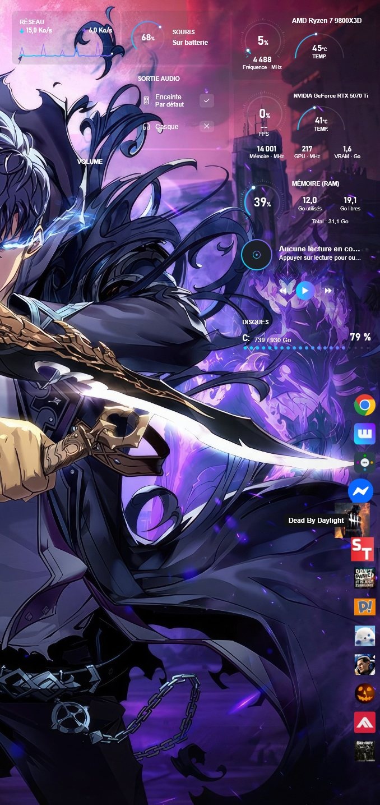
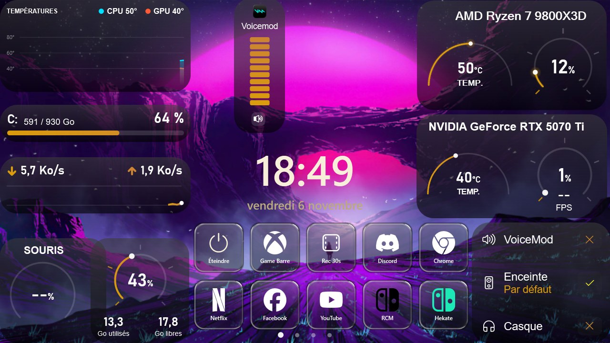
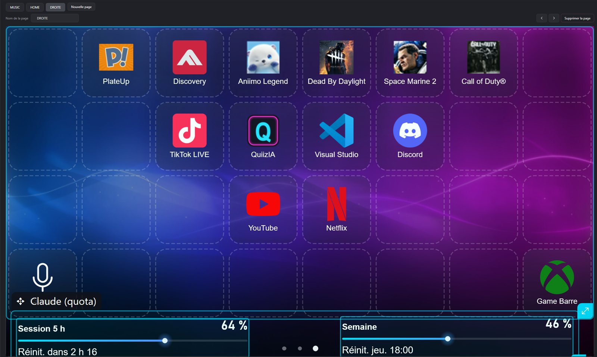
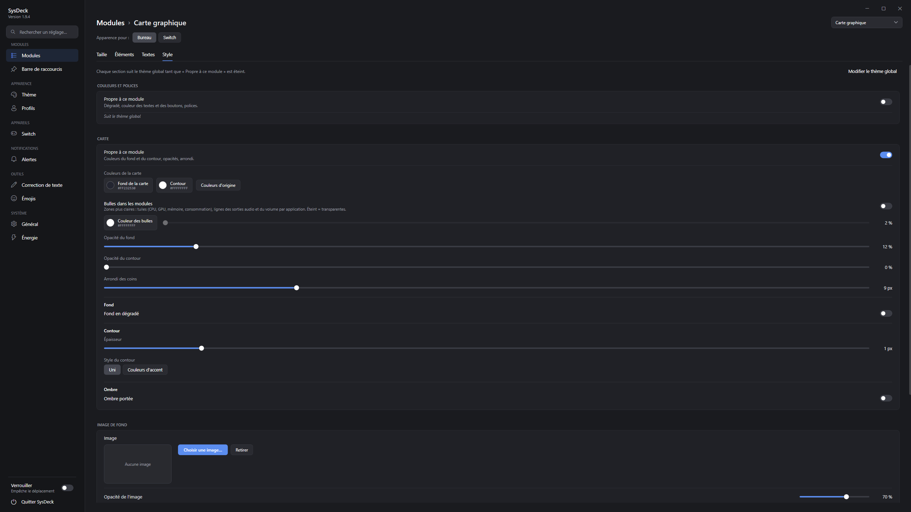
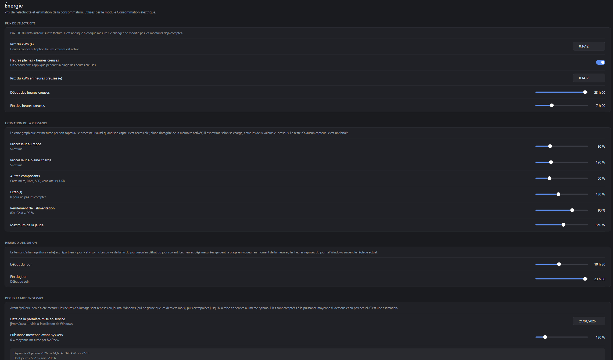
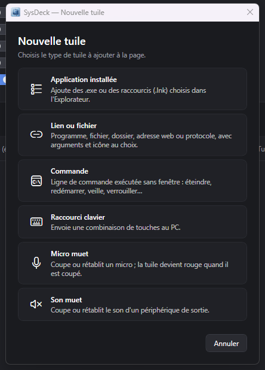
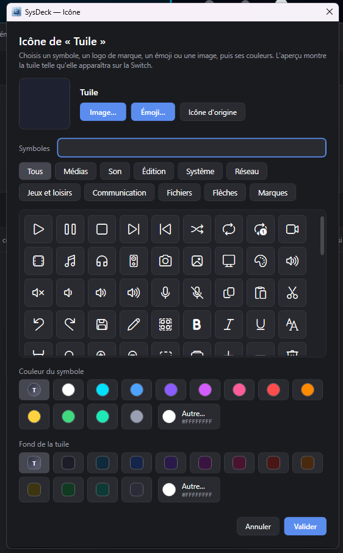

<p align="center"></p>

<h1 align="center">SysDeck</h1>

<p align="center">
Widgets de bureau pour Windows + Nintendo Switch transformée en écran tactile / stream deck USB.<br>
<a href="README.md">English</a> · <b>Français</b>
</p>

---

SysDeck (WPF, .NET 8) affiche des widgets rattachés au bureau (sous les fenêtres, comme les icônes) :
surveillance du matériel, audio, lecture en cours, consommation électrique en euros, barre de raccourcis,
quota Claude et correction de texte par IA. Tout est personnalisable depuis les Paramètres.

Avec le **payload SwitchDeck**, une Nintendo Switch branchée en USB-C devient un second écran tactile
1280×720 : le PC dessine les modules et les tuiles, la Switch les affiche et renvoie le tactile.
Les tuiles pilotent aussi **OBS Studio**, **Twitch** et **Voicemod**, comme un stream deck.

## Aperçu

<table>
  <tr>
    <td width="30%" valign="top"><br><sub>Widgets sur le bureau</sub></td>
    <td valign="top"><br><sub>La Switch branchée en USB-C : matériel, horloge et sortie audio en direct</sub></td>
  </tr>
</table>

<details>
<summary><b>Plus de captures</b></summary>

| | |
|---|---|
| <br><sub>Éditeur de l'écran Switch (aperçu en direct)</sub> | <br><sub>Choix des modules</sub> |
| <br><sub>Personnalisation d'un module</sub> | <br><sub>Réglages de la consommation électrique</sub> |
| <br><sub>Types de tuiles Switch</sub> | <br><sub>Icône d'une tuile : symbole, logo, émoji ou image</sub> |
</details>

## Sommaire

- [Modules](#modules)
- [Compatibilité](#compatibilité)
- [Module Switch (SwitchDeck)](#module-switch-switchdeck)
- [Applications connectées (stream deck)](#applications-connectées-stream-deck)
- [Compiler](#compiler)
- [Organisation du dépôt](#organisation-du-dépôt)
- [Données](#données)
- [Dépannage](#dépannage)
- [Licences et crédits](#licences-et-crédits)

## Modules

| Id | Module | Source des données |
|---|---|---|
| `cpu`, `gpu`, `ram` | Processeur, carte graphique, mémoire | LibreHardwareMonitor (+ `Tools/CpuTempBridge.ps1` pour la température AMD) |
| `network` | Débit réseau | Compteurs des interfaces réseau |
| `disk` | Disques | `DriveInfo` |
| `media` | Lecture en cours | API Windows.Media.Control (Spotify, navigateurs, VLC…) |
| `volumemixer` | Volume par application | Core Audio (NAudio) |
| `audio` | Sortie audio | Core Audio + IPolicyConfig |
| `mouse` | Batterie souris Logitech | HID++ 2.0 (HidSharp) |
| `power` | Consommation en € | Puissance GPU mesurée, CPU estimé, journal Windows pour le passé |
| `claude` | Quota d'utilisation Claude | Jeton de Claude Code (lu seulement) |
| `visualizer` | Visualiseur audio | Capture de la sortie audio (NAudio) |
| `shortcuts` | Barre de raccourcis | `shortcuts.json` |

- **Correction IA** : sélectionner un texte dans n'importe quelle application puis **Ctrl+Espace**
  (clé API Gemini à saisir dans les Paramètres).
- **Sélecteur d'émojis** : un raccourci global (à choisir dans les Paramètres) ouvre, près du curseur, un
  sélecteur avec catégories, recherche et émojis récents ; l'émoji choisi est tapé dans l'application active.
  Les émojis servent aussi d'icônes pour les tuiles de la Switch.
- **Sur le bureau** : **clic droit** sur un module pour le personnaliser, changer sa taille ou celle des textes,
  modifier la disposition, verrouiller les positions ou le masquer ; **Ctrl+molette** pour l'agrandir ou le réduire.
- **Profils et thèmes** : enregistrement, export/import (`.sysdeckprofile`), 8 thèmes prêts à l'emploi.
- **Alertes** : température CPU/GPU, batterie de la souris, quota Claude.

## Compatibilité

La plupart des informations fonctionnent sur n'importe quel PC Windows 10/11 sans réglage : charge du processeur,
mémoire, réseau, disques et carte graphique (NVIDIA, AMD ou Intel). Quelques exceptions :

- **Température du processeur, CPU AMD Ryzen** : installer le SDK AMD Ryzen Master, puis cocher l'option
  « Température du processeur » dans l'installateur de SysDeck.
- **Température du processeur, CPU Intel** : aucun pont n'est fourni ; la température risque de rester vide,
  sauf peut-être en lançant SysDeck en administrateur avec l'Intégrité de la mémoire désactivée (non testé).
- **Batterie de la souris** : seulement les souris Logitech compatibles HID++.

## Module Switch (SwitchDeck)

Le dossier [`payload/`](payload) contient un payload bare-metal lancé depuis
[hekate](https://github.com/CTCaer/hekate). Une fois lancé, la Switch attend SysDeck sur le port USB-C.

- Pages de modules et de tuiles (applications, liens, raccourcis clavier, commandes, son/micro muet,
  OBS Studio, Twitch, Voicemod).
- Glissement entre pages, curseurs au doigt, boutons VOL± = volume de Windows.
- **Mode nuit** : PC éteint, la Switch affiche une image et l'heure (horloge interne recalée par le PC).
- Menu (VOL+ et VOL- en attente) : éteindre, redémarrer, revenir à hekate.

| | | |
|---|---|---|
| <br><sub>Disque, souris, RAM, CPU, GPU, horloge, sortie audio</sub> | <br><sub>Lecture en cours, visualiseur, volume au doigt</sub> | <br><sub>Tuiles d'applications, micro muet, quota Claude</sub> |

Installation : copier `payload/output/switchdeck.bin` dans `sd:/bootloader/payloads/` puis le lancer
depuis hekate (*Payloads*). Le pilote WinUSB est choisi automatiquement par Windows (descripteurs MS OS 2.0).

> Le payload s'exécute directement sur le matériel. Il ne modifie ni la NAND ni le système de la console,
> mais vous l'utilisez à vos risques.

## Applications connectées (stream deck)

Dans **Paramètres → Applications connectées**, **+ Ajouter une application** active OBS Studio, Twitch ou
Voicemod. On crée ensuite des tuiles de ce type dans la page Switch (*Nouvelle tuile*). Les tuiles
affichent l'état en direct (scène active, live ou enregistrement en cours, mode actif, micro coupé…) et
s'atténuent quand l'application n'est pas connectée.

| Application | Connexion | Actions des tuiles |
|---|---|---|
| **OBS Studio** | Serveur WebSocket d'OBS 28+ (*Outils → Paramètres du serveur WebSocket*) : hôte, port, mot de passe | Changer de scène, stream, enregistrement et pause, caméra virtuelle, tampon de relecture et sauvegarde, couper une entrée audio, afficher/masquer une source, transition du mode Studio |
| **Twitch** | « Se connecter à Twitch » : code à valider sur twitch.tv, sans mot de passe dans SysDeck | Clip (lien copié), marqueur, message dans le chat, pub, modes du chat (lent, émotes, followers, abonnés), mode bouclier, titre, catégorie |
| **Voicemod** | Voicemod lancé sur le PC ; autoriser SysDeck dans Voicemod la première fois | Changeur de voix, charger une voix, voix au hasard, jouer un son du soundboard, arrêter les sons, micro, « M'entendre », ambiance |

- **Saisie sur la Switch** : une tuile Twitch *message*, *titre* ou *catégorie* peut demander son texte à
  l'appui. Un clavier AZERTY s'ouvre alors sur la Switch, avec les émotes Twitch du compte, les émojis et une
  recherche de catégories avec jaquettes. Depuis le bureau, une petite fenêtre de saisie s'ouvre sur le PC.
- **Voicemod** : voix et sons choisis dans les listes de Voicemod, avec leur image comme icône. Les sons
  sont classés par soundboard, les vôtres en tête.

## Compiler

### Application Windows

Prérequis : SDK .NET 8 et, pour l'installateur, [Inno Setup 6](https://jrsoftware.org/isinfo.php).

```powershell
# Développement et tests
dotnet build SysDeck.sln -c Debug
dotnet test SysDeck.sln

# Version publiée puis installateur (SysDeck\installer\output\SysDeckSetup.exe)
dotnet publish SysDeck\SysDeck.csproj -c Release -o SysDeck\bin\publish
& "$env:LOCALAPPDATA\Programs\Inno Setup 6\ISCC.exe" SysDeck\installer\SysDeck.iss
```

La version est définie dans `SysDeck.csproj` (`<Version>`) et doit être reportée dans
`installer\SysDeck.iss` (`MyAppVersion`).

La clé de la Control API de Voicemod n'est pas dans le dépôt : elle est intégrée à la compilation depuis
`SysDeck\Secrets\voicemod.key`, un fichier non versionné. Sans ce fichier, tout compile, mais l'intégration
Voicemod indique « clé absente ». Les clés sont délivrées par Voicemod. L'identifiant de l'application
Twitch est public et figure dans le code.

Arguments de lancement : `--settings` ouvre les Paramètres, `--edit-layout` démarre en mode édition
de la disposition. Lancer SysDeck alors qu'il tourne déjà ouvre ses Paramètres.

### Payload Switch

Prérequis : [devkitPro](https://devkitpro.org/wiki/Getting_Started) avec devkitARM, et git.

```powershell
$env:MSYSTEM = 'MSYS'
& C:\devkitPro\msys2\usr\bin\bash.exe -l payload/build.sh          # sortie : payload/output/switchdeck.bin
& C:\devkitPro\msys2\usr\bin\bash.exe -l payload/build.sh clean
```

`build.sh` télécharge au premier lancement la BDK de hekate (version fixée, v6.5.4) dans `third_party/hekate`.

Le protocole USB est défini deux fois et doit rester identique :
`payload/src/deck_proto.h` (Switch) et `SysDeck/Deck/DeckProtocol.cs` (PC).

## Organisation du dépôt

```
├── SysDeck/                 Application WPF
│   ├── App.xaml(.cs)        Démarrage : instance unique, gestion globale des erreurs, icône de notification
│   ├── WidgetManager*.cs    Registre des modules, création des fenêtres, rafraîchissements
│   ├── Windows/             Fenêtres : cadre d'un module, Paramètres, ajout de raccourci/tuile
│   ├── Widgets/             Contenu de chaque module (XAML + affichage, sans logique métier)
│   ├── Controls/            Contrôles réutilisables : jauges, graphe, éditeur de thème, disposition libre
│   ├── Deck/                Module Switch : protocole et lien USB, rendu de l'écran, tuiles, clavier, mode nuit
│   ├── Services/            Logique métier et accès système (capteurs, audio, médias, consommation, profils,
│   │                        OBS, Twitch, Voicemod)
│   ├── Infrastructure/      Transversal : chemins, journal, fichiers JSON sûrs, instance unique
│   ├── Interop/             Appels Win32/COM (bureau, raccourci global, clavier simulé, sortie audio)
│   ├── Converters/, Models/, Themes/, Assets/
│   ├── Tools/               Pont de température CPU (tâche planifiée élevée), PresentMon (FPS)
│   └── installer/           Script Inno Setup
├── SysDeck.Tests/           Tests xUnit
├── payload/                 Payload Switch en C (GPL-2.0)
└── docs/                    Images de la documentation
```

Règles suivies :

- **Un module défaillant n'arrête jamais les autres** : chaque lecture est protégée, les erreurs
  répétitives ne sont journalisées qu'une fois par session (`Log.WarnOnce`).
- **Aucune donnée perdue** : écriture atomique des fichiers ; un fichier illisible est mis de côté
  (`*.corrupt-date.json`) au lieu d'être écrasé.
- **Ressources système libérées** : objets COM audio, processus, handles d'icônes.

## Données

Tout est dans `%AppData%\SysDeck` :

| Fichier / dossier | Contenu |
|---|---|
| `config.json` | Réglages, thème, apparence des modules, positions, Switch, applications connectées. La clé Gemini, le mot de passe OBS et les jetons Twitch y sont chiffrés (DPAPI, compte Windows courant) et ne sont jamais exportés dans les profils. |
| `shortcuts.json` | Raccourcis de la barre |
| `power-usage.json` | Historique de consommation |
| `Icons/`, `Backgrounds/`, `Fonts/` | Copies des icônes, images de fond et polices importées |
| `logs/sysdeck.log` | Journal (1 Mo max, l'ancien est conservé en `sysdeck.old.log`) |

La variable d'environnement `SYSDECK_DATA_DIR` permet d'utiliser un autre dossier (tests, profil
portable) ; une instance par dossier de données.

## Dépannage

- **Un module reste vide** : consulter `%AppData%\SysDeck\logs\sysdeck.log`.
- **Température CPU absente** : l'Intégrité de la mémoire bloque le pilote de LibreHardwareMonitor ;
  activer l'option « Température du processeur » de l'installateur (SDK AMD Ryzen Master requis).
- **Ctrl+Espace sans effet** : le raccourci est pris par une autre application (voir le journal).
- **Switch non détectée** : vérifier que le payload affiche « En attente du PC » et utiliser un câble USB-C de données.
- **Application connectée en erreur** : la carte de l'application (Paramètres → Applications connectées)
  indique la raison. Vérifier qu'OBS ou Voicemod est lancé. Pour Twitch, se déconnecter puis se reconnecter
  après une mise à jour qui demande de nouveaux droits (émotes).

## Licences et crédits

- Application Windows (tout sauf `payload/`) : [MIT](LICENSE).
- Payload Switch (`payload/`) : [GPL-2.0](payload/LICENSE), car il repose sur la BDK de
  [hekate](https://github.com/CTCaer/hekate) (CTCaer, naehrwert).
- [LibreHardwareMonitor](https://github.com/LibreHardwareMonitor/LibreHardwareMonitor) (MPL-2.0),
  [NAudio](https://github.com/naudio/NAudio) (MIT), [HidSharp](https://www.zer7.com/software/hidsharp) (Apache-2.0),
  [Emoji.Wpf](https://github.com/samhocevar/emoji.wpf) (WTFPL).
- [PresentMon](https://github.com/GameTechDev/PresentMon) (Intel, MIT) pour la mesure des FPS.
- Logos de marques : [Simple Icons](https://simpleicons.org) (CC0) — les marques appartiennent à leurs propriétaires.

Nintendo Switch est une marque de Nintendo. OBS Studio, Twitch et Voicemod sont des marques de leurs
propriétaires respectifs. Ce projet n'est ni affilié ni approuvé par Nintendo, OBS, Twitch ou Voicemod.
