<p align="center">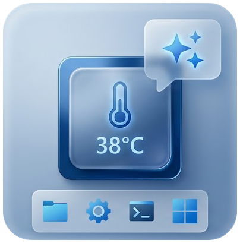</p>

<h1 align="center">SysDeck</h1>

<p align="center">
Desktop widgets for Windows + a Nintendo Switch turned into a USB touch screen / stream deck.<br>
<b>English</b> · <a href="README.fr.md">Français</a>
</p>

---

SysDeck (WPF, .NET 8) shows widgets pinned to the desktop (below windows, like desktop icons):
hardware monitoring, audio, now playing, power cost in euros, a shortcut bar, Claude usage quota
and AI text correction. Everything can be customized from the Settings window.

With the **SwitchDeck payload**, a Nintendo Switch plugged in over USB-C becomes a second 1280×720
touch screen: the PC renders the modules and tiles, the Switch displays them and sends touch input back.
Tiles, drawn as Stream Deck-style **3D glass buttons**, can also control **OBS Studio**, **Twitch** and **Voicemod**,
and run **plugins**: SysDeck plugins and open-source **Elgato Stream Deck** plugins, installed from a GitHub catalog.

> The user interface is in French.

## Screenshots

<table>
  <tr>
    <td width="30%" valign="top">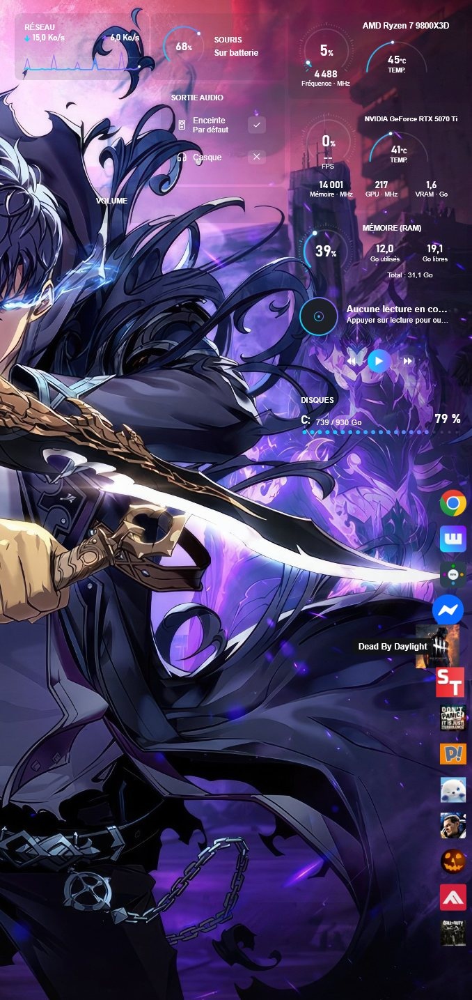<br><sub>Desktop widgets</sub></td>
    <td valign="top">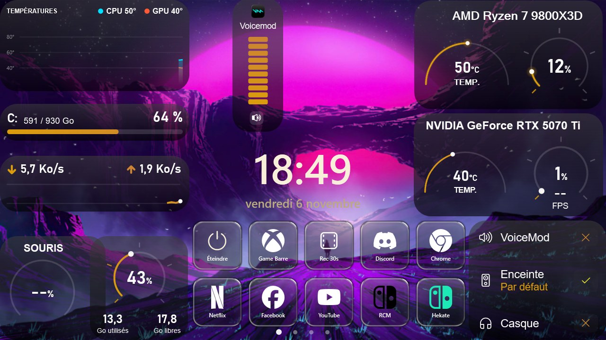<br><sub>The Switch plugged in over USB-C: live hardware stats, clock and audio output</sub></td>
  </tr>
</table>

<details>
<summary><b>More screenshots</b></summary>

| | |
|---|---|
| 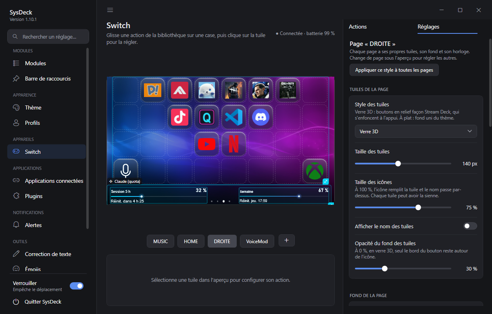<br><sub>Switch page: live preview, pages, per-page settings</sub> | 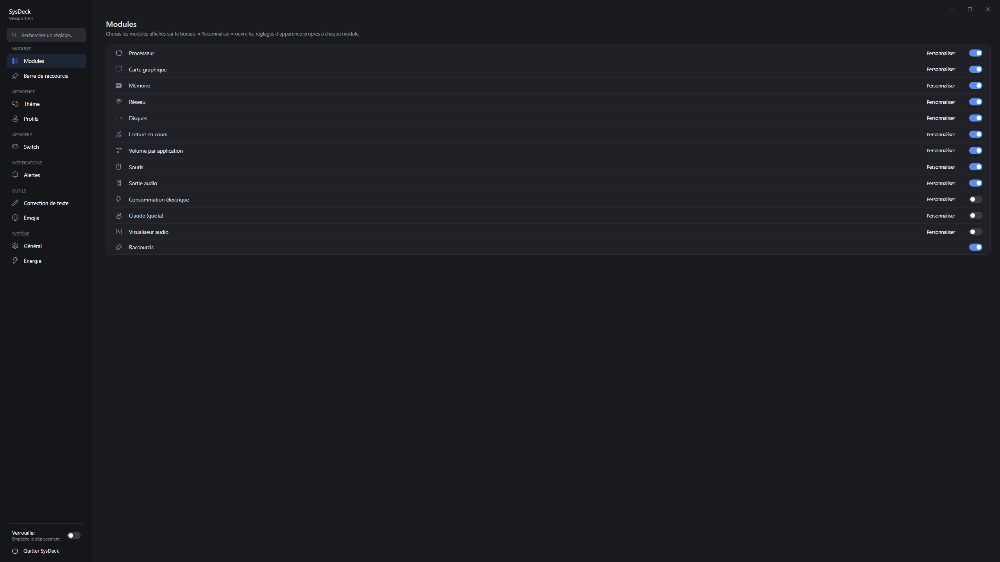<br><sub>Module selection</sub> |
| 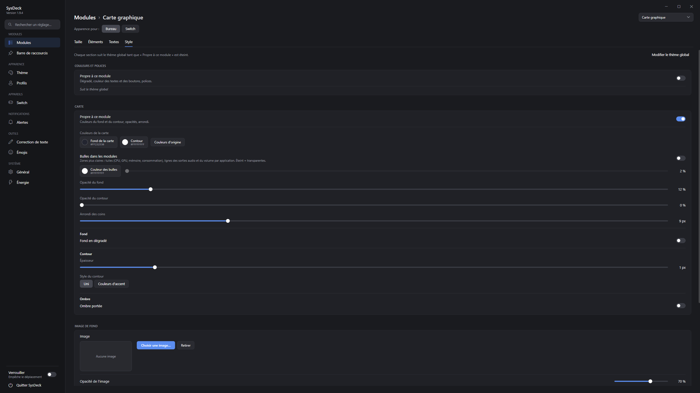<br><sub>Module customization</sub> | 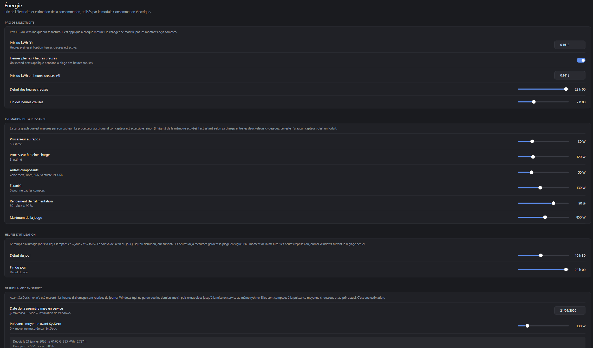<br><sub>Power usage settings</sub> |
| 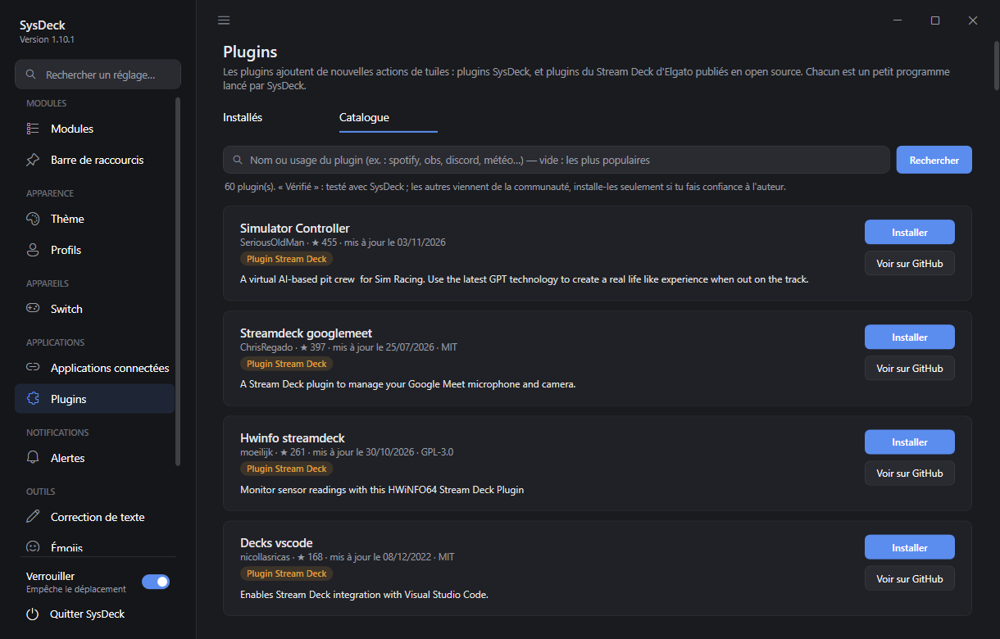<br><sub>Plugin catalog (GitHub), including Stream Deck plugins</sub> | 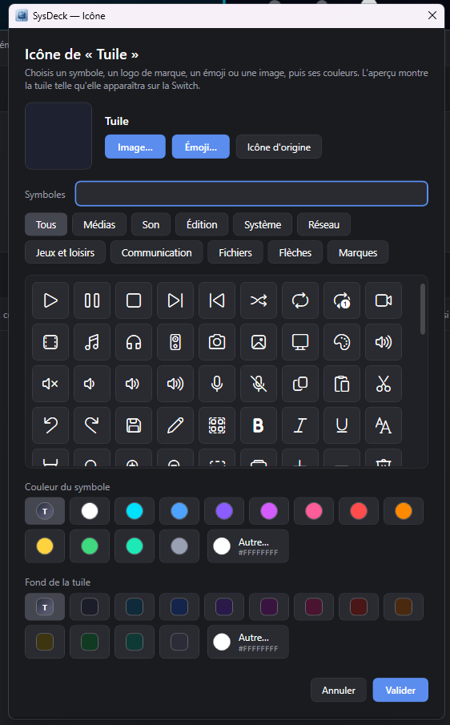<br><sub>Tile icon: symbol, brand logo, emoji or image</sub> |

</details>

## Contents

- [Modules](#modules)
- [Compatibility](#compatibility)
- [Switch module (SwitchDeck)](#switch-module-switchdeck)
- [Connected apps (stream deck)](#connected-apps-stream-deck)
- [Building](#building)
- [Repository layout](#repository-layout)
- [Data](#data)
- [Troubleshooting](#troubleshooting)
- [Licenses and credits](#licenses-and-credits)

## Modules

| Id | Module | Data source |
|---|---|---|
| `cpu`, `gpu`, `ram` | CPU, GPU, memory | LibreHardwareMonitor (+ `Tools/CpuTempBridge.ps1` for AMD CPU temperature) |
| `network` | Network throughput | Network interface counters |
| `disk` | Drives | `DriveInfo` |
| `media` | Now playing | Windows.Media.Control API (Spotify, browsers, VLC…) |
| `volumemixer` | Per-app volume | Core Audio (NAudio) |
| `audio` | Audio output | Core Audio + IPolicyConfig |
| `mouse` | Logitech mouse battery | HID++ 2.0 (HidSharp) |
| `power` | Power cost in € | Measured GPU power, estimated CPU, Windows event log for history |
| `claude` | Claude usage quota | Claude Code token (read only) |
| `visualizer` | Audio visualizer | Audio output capture (NAudio) |
| `shortcuts` | Shortcut bar | `shortcuts.json` |

- **AI correction**: select text in any application and press **Ctrl+Space**
  (Gemini API key set in Settings).
- **Emoji picker**: a global hotkey (chosen in Settings) opens a picker near the cursor with categories,
  search and recent emojis; the selected emoji is typed into the active application.
  Emojis can also be used as icons for Switch tiles.
- **On the desktop**: **right-click** a module to customize it, resize it or its text, edit the layout,
  lock positions or hide it; **Ctrl+mouse wheel** to scale it.
- **Profiles and themes**: save, export/import (`.sysdeckprofile`), 8 built-in themes.
- **Alerts**: CPU/GPU temperature, mouse battery, Claude quota.

## Compatibility

Most readings work on any Windows 10/11 PC with no setup: CPU load, memory, network, drives and graphics card
(NVIDIA, AMD or Intel). A few exceptions:

- **CPU temperature, AMD Ryzen**: install the AMD Ryzen Master SDK, then tick the "CPU temperature"
  option in the SysDeck installer.
- **CPU temperature, Intel**: no bridge is provided; the temperature will likely stay empty, except perhaps
  when running SysDeck as administrator with Memory Integrity turned off (untested).
- **Mouse battery**: Logitech mice supporting HID++ only.

## Switch module (SwitchDeck)

The [`payload/`](payload) folder contains a bare-metal payload launched from
[hekate](https://github.com/CTCaer/hekate). Once running, the Switch waits for SysDeck on its USB-C port.

- Pages of modules and tiles (apps, links, keyboard shortcuts, commands, speaker/mic mute,
  OBS Studio, Twitch, Voicemod, plugins).
- **Stream Deck-style Switch settings page**: live preview in the middle, pages below, an action library on the
  right (click, or drag onto a cell) and an inspector for the selected tile (name, action, icon, plugin settings).
  The left menu can be hidden (☰ or Ctrl+B).
- **3D glass buttons** that press in when touched, or flat tiles; transparent background available.
- **Each page has its own style**: tile and icon size (up to filling the tile), glass or flat, names, background
  (color, image), clock. "Apply this style to all pages" in one click.
- **Active tile** (mic muted, live on air, active scene…): custom color and second icon, button that stays pressed.
- Swipe between pages, touch sliders, VOL± buttons control the Windows volume.
- **Night mode**: with the PC off, the Switch shows a picture and the time (internal clock synced by the PC).
- Menu (VOL+ and VOL- while waiting): power off, reboot, return to hekate.

| | | |
|---|---|---|
| <br><sub>Drive, mouse, RAM, CPU, GPU, clock, audio output</sub> | 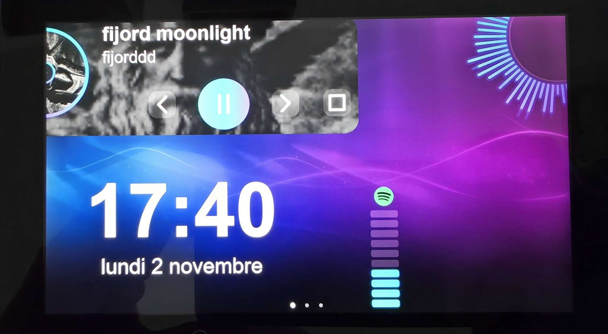<br><sub>Now playing, visualizer, touch volume</sub> | 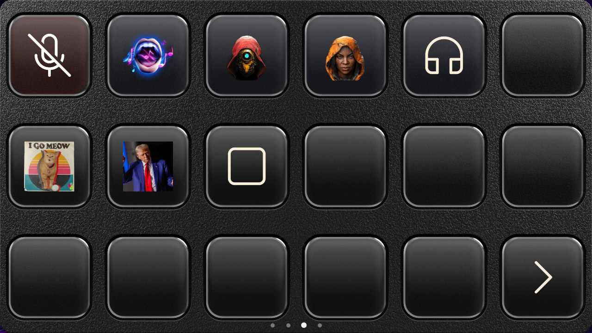<br><sub>App tiles, mic mute, Claude quota</sub> |

Install: copy `payload/output/switchdeck.bin` to `sd:/bootloader/payloads/` and launch it from
hekate (*Payloads*). Windows installs the WinUSB driver automatically (Microsoft OS descriptors).

> The payload runs directly on the hardware. It does not touch the console's NAND or system software,
> but use it at your own risk.

## Connected apps (stream deck)

In **Settings → Applications connectées** (connected apps), **+ Ajouter une application** enables OBS Studio,
Twitch or Voicemod. You then create tiles of that type from the Switch page's action library. Tiles show the
live state (active scene, streaming or recording, mode on, mic muted…) and are dimmed while the app is not
connected.

| App | Connection | Tile actions |
|---|---|---|
| **OBS Studio** | OBS 28+ WebSocket server (*Tools → WebSocket Server Settings*): host, port, password | Switch scene, stream, record and pause, virtual camera, replay buffer and save, mute an audio input, show/hide a source, Studio Mode transition |
| **Twitch** | "Se connecter à Twitch": confirm a code on twitch.tv, no password in SysDeck | Clip (link copied), marker, chat message, ad, chat modes (slow, emote-only, followers, subscribers), Shield Mode, title, category |
| **Voicemod** | Voicemod running on the PC; allow SysDeck in Voicemod the first time | Voice changer, load a voice, random voice, play a soundboard sound, stop sounds, mic, Hear Myself, background effect |

- **Typing on the Switch**: a Twitch *message*, *title* or *category* tile can ask for its text when pressed.
  An AZERTY keyboard then opens on the Switch, with the account's Twitch emotes, emojis and a category search
  with box art. From the desktop, a small input window opens on the PC instead.
- **Voicemod**: voices and sounds are picked from Voicemod's own lists and use their picture as the tile icon.
  Sounds are grouped by soundboard, your own first.

## Plugins and icon packs

- **Plugins**: a plugin is a small program (exe, Node.js, Python or PowerShell) talking to SysDeck over a local
  WebSocket. Its actions show up in the Switch page's action library; it can update its tiles' title, image and
  state live.
  - **Catalog** (Settings → Plugins): GitHub search (topics `sysdeck-plugin`, `streamdeck-plugin`), one-click install
    of the latest release, and updates. "Verified" plugins are listed in [plugins/catalogue.json](plugins/catalogue.json).
  - **Elgato Stream Deck plugins**: open-source plugins (unencrypted `.streamDeckPlugin`, `.sdPlugin` folder) work,
    with their property inspector shown in the tile inspector (WebView2). Node.js is downloaded once from nodejs.org
    if the PC has none. Elgato Marketplace plugins are encrypted and do not work; neither do dial actions (Stream Deck +).
  - Writing a plugin: [docs/plugins.md](docs/plugins.md) (French) and the [plugins/exemple-compteur](plugins/exemple-compteur) sample.
- **Icon packs**: in a tile's icon chooser, **Pack d'icônes…** imports a Stream Deck icon pack
  (`.streamDeckIconPack`, SVG icons included), a zip or a folder of images. Each pack becomes a searchable category
  (name and tags). An image (monochrome pack icon) can be recolored.

## Building

### Windows application

Requirements: .NET 8 SDK and, for the installer, [Inno Setup 6](https://jrsoftware.org/isinfo.php).

```powershell
# Development and tests
dotnet build SysDeck.sln -c Debug
dotnet test SysDeck.sln

# Release build then installer (SysDeck\installer\output\SysDeckSetup.exe)
dotnet publish SysDeck\SysDeck.csproj -c Release -o SysDeck\bin\publish
& "$env:LOCALAPPDATA\Programs\Inno Setup 6\ISCC.exe" SysDeck\installer\SysDeck.iss
```

The version is set in `SysDeck.csproj` (`<Version>`) and must be mirrored in
`installer\SysDeck.iss` (`MyAppVersion`).

The Voicemod Control API key is not in the repository: it is embedded at build time from
`SysDeck\Secrets\voicemod.key`, an untracked file. Without it everything builds, but the Voicemod integration
reports a missing key. Keys are issued by Voicemod. The Twitch application client ID is public and lives
in the code.

Command-line arguments: `--settings` opens Settings, `--edit-layout` starts in layout edit mode.
Launching SysDeck while it is already running opens its Settings.

### Switch payload

Requirements: [devkitPro](https://devkitpro.org/wiki/Getting_Started) with devkitARM, and git.

```powershell
$env:MSYSTEM = 'MSYS'
& C:\devkitPro\msys2\usr\bin\bash.exe -l payload/build.sh          # output: payload/output/switchdeck.bin
& C:\devkitPro\msys2\usr\bin\bash.exe -l payload/build.sh clean
```

On first run, `build.sh` downloads the hekate BDK (pinned to v6.5.4) into `third_party/hekate`.

The USB protocol is defined twice and both copies must stay identical:
`payload/src/deck_proto.h` (Switch) and `SysDeck/Deck/DeckProtocol.cs` (PC).

## Repository layout

```
├── SysDeck/                 WPF application
│   ├── App.xaml(.cs)        Startup: single instance, global error handling, tray icon
│   ├── WidgetManager*.cs    Module registry, window creation, refresh loop
│   ├── Windows/             Windows: module frame, Settings, shortcut/tile dialogs
│   ├── Widgets/             Each module's content (XAML + display, no business logic)
│   ├── Controls/            Reusable controls: gauges, graph, theme editor, free layout
│   ├── Deck/                Switch module: protocol and USB link, screen rendering, tiles, keyboard, night mode
│   ├── Services/            Business logic and system access (sensors, audio, media, power, profiles,
│   │                        OBS, Twitch, Voicemod, icon packs, SVG)
│   ├── Plugins/             Plugins: manifests (SysDeck and Stream Deck), WebSocket host, Node.js, GitHub catalog
│   ├── Infrastructure/      Cross-cutting: paths, logging, safe JSON files, single instance
│   ├── Interop/             Win32/COM calls (desktop, global hotkey, simulated input, audio output)
│   ├── Converters/, Models/, Themes/, Assets/
│   ├── Tools/               CPU temperature bridge (elevated scheduled task), PresentMon (FPS)
│   └── installer/           Inno Setup script
├── SysDeck.Tests/           xUnit tests
├── payload/                 Switch payload in C (GPL-2.0)
├── plugins/                 Sample plugin and the catalog's verified plugin list
└── docs/                    Documentation images, plugin guide
```

Design rules:

- **A failing module never stops the others**: every read is guarded, repeated errors are logged
  only once per session (`Log.WarnOnce`).
- **No data loss**: files are written atomically; an unreadable file is set aside
  (`*.corrupt-date.json`) instead of being overwritten.
- **System resources are released**: audio COM objects, processes, icon handles.

## Data

Everything lives in `%AppData%\SysDeck`:

| File / folder | Content |
|---|---|
| `config.json` | Settings, theme, module appearance, positions, Switch, connected apps. The Gemini key, the OBS password and the Twitch tokens are encrypted (DPAPI, current Windows account) and never exported in profiles. |
| `shortcuts.json` | Shortcut bar entries |
| `power-usage.json` | Power usage history |
| `Icons/`, `Backgrounds/`, `Fonts/` | Copies of imported icons, background images and fonts |
| `IconPacks/` | Imported icon packs (SVG converted to PNG) |
| `Plugins/`, `logs/plugins/` | Installed plugins and their logs |
| `Runtime/`, `WebView2/` | Node.js downloaded for plugins, profile of the plugin settings page engine |
| `logs/sysdeck.log` | Log (1 MB max, the previous one is kept as `sysdeck.old.log`) |

The `SYSDECK_DATA_DIR` environment variable points to another folder (tests, portable profile);
one instance runs per data folder.

## Troubleshooting

- **A module stays empty**: check `%AppData%\SysDeck\logs\sysdeck.log`.
- **No CPU temperature**: Memory Integrity blocks the LibreHardwareMonitor driver; enable the
  "CPU temperature" option in the installer (requires the AMD Ryzen Master SDK).
- **Ctrl+Space does nothing**: another application owns the hotkey (see the log).
- **Switch not detected**: make sure the payload shows "En attente du PC" and use a USB-C data cable.
- **Connected app in error**: the app's card (Settings → Applications connectées) shows the reason. Make sure
  OBS or Voicemod is running. For Twitch, sign out and back in after an update that asks for new permissions
  (emotes).

## Licenses and credits

- Windows application (everything except `payload/`): [MIT](LICENSE).
- Switch payload (`payload/`): [GPL-2.0](payload/LICENSE), because it is built on the
  [hekate](https://github.com/CTCaer/hekate) BDK (CTCaer, naehrwert).
- [LibreHardwareMonitor](https://github.com/LibreHardwareMonitor/LibreHardwareMonitor) (MPL-2.0),
  [NAudio](https://github.com/naudio/NAudio) (MIT), [HidSharp](https://www.zer7.com/software/hidsharp) (Apache-2.0),
  [Emoji.Wpf](https://github.com/samhocevar/emoji.wpf) (WTFPL).
- [PresentMon](https://github.com/GameTechDev/PresentMon) (Intel, MIT) for FPS measurement.
- Brand logos: [Simple Icons](https://simpleicons.org) (CC0) — trademarks belong to their owners.
- [SharpVectors](https://github.com/ElinamLLC/SharpVectors) (BSD-3-Clause) for SVG icons,
  [WebView2](https://developer.microsoft.com/microsoft-edge/webview2/) (Microsoft) for plugin settings pages,
  [Node.js](https://nodejs.org) (MIT, downloaded on demand) for JavaScript plugins.

Nintendo Switch is a trademark of Nintendo. Stream Deck and Elgato are trademarks of Corsair. OBS Studio, Twitch and Voicemod are trademarks of their
respective owners. This project is not affiliated with or endorsed by Nintendo, OBS, Twitch or Voicemod.
