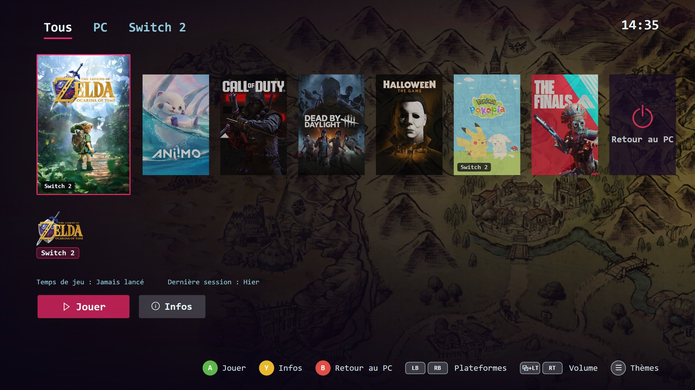
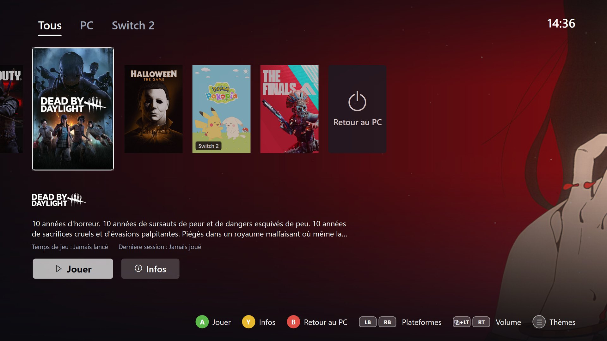
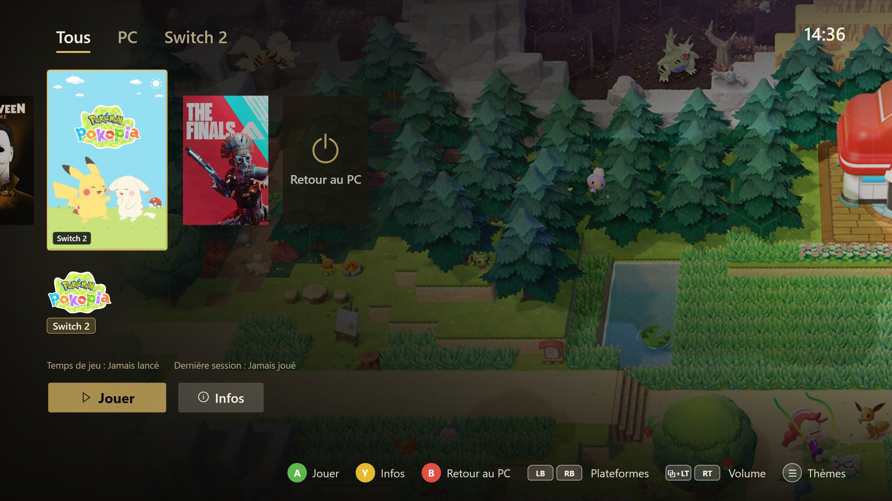
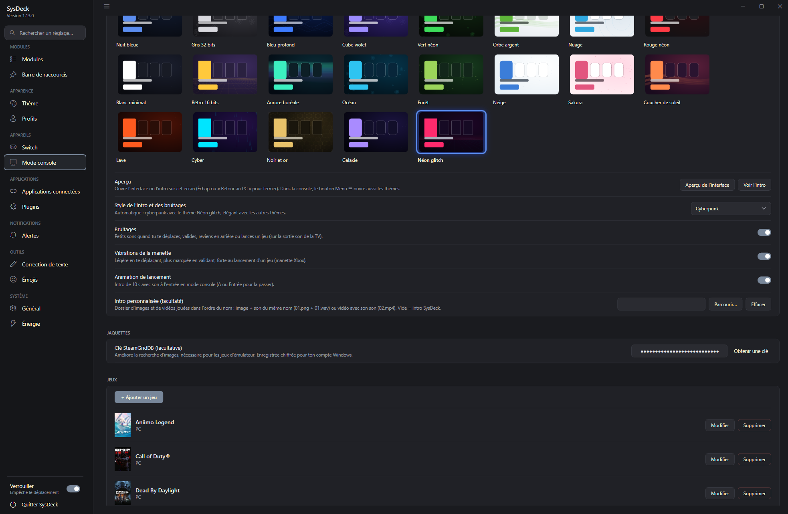

<p align="center"></p>

<h1 align="center">SysDeck</h1>

<p align="center">
Desktop widgets for Windows + a Nintendo Switch turned into a USB touch screen / stream deck.<br>
<b>English</b> · <a href="README.fr.md">Français</a>
</p>

---

SysDeck (WPF, .NET 8) shows widgets pinned to the desktop (below windows, like desktop icons):
hardware monitoring, audio, now playing, clocks, calendar, weather, power cost in euros, a shortcut bar,
Claude usage quota and AI text correction. Everything can be customized from the Settings window.

With the **SwitchDeck payload**, a Nintendo Switch plugged in over USB-C becomes a second 1280×720
touch screen: the PC renders the modules and tiles, the Switch displays them and sends touch input back.
Tiles, drawn as Stream Deck-style **3D glass buttons**, can also control **OBS Studio**, **Twitch** and **Voicemod**,
and run **plugins**: SysDeck plugins and open-source **Elgato Stream Deck** plugins, installed from a GitHub catalog.
The Joy-Con attached to the Switch can trigger SysDeck actions too.

> The user interface is in French.

## Screenshots

<table>
  <tr>
    <td width="30%" valign="top"><br><sub>Desktop widgets</sub></td>
    <td valign="top"><br><sub>The Switch plugged in over USB-C: live hardware stats, clock and audio output</sub></td>
  </tr>
</table>

<details>
<summary><b>More screenshots</b></summary>

| | |
|---|---|
| <br><sub>Switch page: live preview, pages, tile inspector and icon editor</sub> | <br><sub>Click a widget in the preview: all of its Switch settings below</sub> |
| <br><sub>Joy-Con view: an action for each button, per page if needed</sub> | <br><sub>Module selection</sub> |
| <br><sub>Module customization: clickable preview, card, gauges, animations</sub> | <br><sub>Connected apps: OBS Studio, Twitch, Voicemod</sub> |
| <br><sub>Alerts: CPU and GPU temperature, mouse battery, Claude quota</sub> | <br><sub>General: FPS measurement, hidden items, reset</sub> |

</details>

## Contents

- [Modules](#modules)
- [Compatibility](#compatibility)
- [Switch module (SwitchDeck)](#switch-module-switchdeck)
- [Connected apps (stream deck)](#connected-apps-stream-deck)
- [Console mode](#console-mode)
- [Building](#building)
- [Repository layout](#repository-layout)
- [Data](#data)
- [Troubleshooting](#troubleshooting)
- [Licenses and credits](#licenses-and-credits)

## Modules

| Id | Module | Data source |
|---|---|---|
| `cpu`, `gpu`, `ram` | CPU, GPU, memory | LibreHardwareMonitor (+ `Tools/CpuTempBridge.ps1` for AMD CPU temperature) |
| `network` | Network throughput | Network interface counters |
| `disk` | Drives | `DriveInfo` |
| `media` | Now playing: 4 layouts, time bar, shuffle/repeat | Windows.Media.Control API (Spotify, browsers, VLC…) |
| `volumemixer` | Per-app volume | Core Audio (NAudio) |
| `audio` | Audio output | Core Audio + IPolicyConfig |
| `mouse` | Logitech mouse battery | HID++ 2.0 (HidSharp) |
| `power` | Power cost in € | Measured GPU power, estimated CPU, Windows event log for history |
| `claude` | Claude usage quota | Claude Code token (read only) |
| `visualizer` | Audio visualizer | Audio output capture (NAudio) |
| `tileclock` | Digital clock on colored tiles (HH:MM:SS) | System clock |
| `analogclock` | Analog clock with date | System clock |
| `calendar` | Month calendar | System clock |
| `weather` | Weather and 4-day forecast | [Open-Meteo](https://open-meteo.com) (free, no account) |
| `moon` | Moon phase: real Moon picture shaded to the current phase, phase name, illumination, next phases | Computed offline (Meeus terms, within a few hours) |
| `sun` | Sunrise and sunset: sun path, times, day length, next event | Open-Meteo, same city as the weather |
| `airquality` | Air quality (European AQI, PM2.5, PM10, NO₂, O₃) | Open-Meteo, same city as the weather |
| `temperatures` | CPU and GPU temperature curves on one chart | LibreHardwareMonitor |
| `sensorbars` | Bars for any sensor (temperatures, loads, RAM, VRAM, fans…) | LibreHardwareMonitor |
| `simhub` | Sim racing: gear, speed, RPM, lap times, position, fuel | [SimHub](https://www.simhubdash.com) + the [SimHub Property Server](https://github.com/pre-martin/SimHubPropertyServer) plugin |
| `shortcuts` | Shortcut bar | `shortcuts.json` |

- **AI correction**: select text in any application and press **Ctrl+Space**
  (Gemini API key set in Settings).
- **Emoji picker**: a global hotkey (chosen in Settings) opens a picker near the cursor with categories,
  search and recent emojis; the selected emoji is typed into the active application.
  Emojis can also be used as icons for Switch tiles.
- **On the desktop**: **right-click** a module to customize it, resize it or its text, edit the layout,
  lock positions or hide it; **Ctrl+mouse wheel** to scale it.
- **Profiles and themes**: save, export/import (`.sysdeckprofile`), 9 built-in themes (including "Edge noir":
  matte black cards, thin gauges, orange accent).
- **Module settings**: the clocks, weather, air quality, temperature, sensor bar, SimHub and media options are in the
  module's own customization page (Style tab). New modules are hidden until you turn them on.
- **Now playing**: Compact, Banner (large cover), Vinyl (spinning record with the cover as its label) or Sleeve
  (cover with the record sliding out) layouts; thin, thick or segmented time bar (click to seek); buttons with or
  without background; shuffle and repeat. Cover, track, time bar and buttons can be moved.
- **Sensor bars**: pick any reading, one horizontal (or vertical) bar each; segmented, solid or gradient bars,
  color per bar, glow, alert color above a threshold.
- **Color picker**: the Windows color dialog now remembers its custom colors.
- **Alerts**: CPU/GPU temperature, mouse battery, Claude quota.

## Compatibility

Most readings work on any Windows 10/11 PC with no setup: CPU load, memory, network, drives and graphics card
(NVIDIA, AMD or Intel). A few exceptions:

- **CPU temperature, AMD Ryzen**: install the AMD Ryzen Master SDK, then tick the "CPU temperature"
  option in the SysDeck installer.
- **CPU temperature, Intel**: no bridge is provided; the temperature will likely stay empty, except perhaps
  when running SysDeck as administrator with Memory Integrity turned off (untested).
- **Mouse battery**: Logitech mice supporting HID++ only.
- **Fans**: graphics card fans are read with no setup. Motherboard fans (CPU, case) need the low-level driver that
  Memory Integrity blocks; they show up in the sensor list only when Windows allows it.

## Switch module (SwitchDeck)

The [`payload/`](payload) folder contains a bare-metal payload launched from
[hekate](https://github.com/CTCaer/hekate). Once running, the Switch waits for SysDeck on its USB-C port.

- Pages of modules and tiles (apps, links, keyboard shortcuts, commands, speaker/mic mute,
  OBS Studio, Twitch, Voicemod, plugins).
- The **Tuiles de la page** (page tiles) widget can have its own subpages, independent of the Switch's full-screen pages.
  In a tile's inspector, choose **Page du widget → Nouvelle page** to move it and create a subpage, then add
  **Page précédente** and **Page suivante** actions from the library to navigate between them. The arrows wrap at either end.
  Each arrow tile can also be mapped to a Joy-Con button: it controls that arrow on the Switch page where it is mapped,
  and the button's usual Joy-Con assignment is restored on other pages.
- Switch system actions in the page library: power off into RCM, or relaunch hekate from
  `bootloader/update.bin` or `payload.bin` on the SD card. Both require a second tap to prevent accidental activation.
- **Stream Deck-style Switch settings page**: live preview in the middle, page previews below, and a resizable
  right-hand panel for the action library and settings for the selected tile or Joy-Con control. Click or drag an
  action onto a tile; the left menu can be hidden (☰ or Ctrl+B).
- **Page layout editor**: drag and resize modules and their elements directly in the live preview, use the
  alignment grid and guides, or Ctrl-click to select and move/resize several elements together. Apply a balanced,
  gaming, monitoring or compact layout as a starting point, then adjust it freely. The tile grid can use automatic
  sizing or a chosen number of columns.
- **Page transitions**: choose none, slide, fade, slide-and-fade or zoom, then adjust duration and easing.
- **3D glass buttons** that press in when touched, or flat tiles; transparent background available. In glass style,
  empty cells show blank buttons, like the unused keys of a real Stream Deck.
- **Stream Deck-style tile widget**: optional rounded background (color or texture — a black grain texture is built in,
  and you can add your own), with each button recessed in its own well. The tile grid fills the widget: smaller tiles
  add more columns and rows (up to 16 × 9), and the remaining space is spread evenly between the cells.
- **Inspector for widgets and tiles**: click a widget in the Switch preview to edit all of its Switch settings right
  below it (colors, card, animations, texts, buttons, show or hide each element, size on screen), with a clickable
  preview of the widget. For a tile: custom icon size independent of the page setting, and show or hide its name
  independently of the other tiles.
- **Each page has its own style**: tile and icon size (up to filling the tile), glass or flat, names, background
  (color, image), clock. "Apply this style to all pages" in one click.
- **Active tile** (mic muted, live on air, active scene…): custom color and second icon, button that stays pressed.
- **Joy-Con** (payload v6): the Joy-Con attached to the Switch (or a Switch Lite's controls) trigger actions. The
  "Manettes (Joy-Con)" view shows just the two controllers in a neutral style: click a button (or drop an action from
  the library on it) to assign a tile action, page change, direct jump to a chosen page (e.g. X → Home, Y → Media),
  a cursor moving over the tiles or the volume. Sticks:
  tile cursor, volume, mouse or scroll. Assignments are shared by all pages or specific to one page. With the PC off,
  the Joy-Con can charge when the Switch detects external USB power; they stay off on battery to preserve the console's charge.
- The new Switch system actions require SwitchDeck payload protocol v7 or later.
- Swipe between pages, touch sliders, VOL± buttons control the Windows volume.
- **Night mode**: with the PC off, the Switch shows a picture and the time (internal clock synced by the PC).
- Menu (VOL+ and VOL- while waiting): power off, reboot, return to hekate.

| | |
|---|---|
| <br><sub>Temperatures, drive, network, RAM, CPU, GPU, Voicemod, clock, glass tiles, audio output</sub> | <br><sub>Now playing, visualizer, Voicemod, audio output</sub> |
| <br><sub>Stream Deck-style tiles: textured plate, recessed glass buttons</sub> | <br><sub>Weather, flip clock, air quality, calendar, moon, Claude quota, sensor bars</sub> |

Install: copy `payload/output/switchdeck.bin` to `sd:/bootloader/payloads/` and launch it from
hekate (*Payloads*). Windows installs the WinUSB driver automatically (Microsoft OS descriptors).

> The payload runs directly on the hardware. It does not touch the console's NAND or system software,
> but use it at your own risk.

## Connected apps (stream deck)

In **Settings → Applications connectées** (connected apps), **+ Ajouter une application** enables OBS Studio,
Twitch or Voicemod. You then create tiles of that type from the Switch page's action library. Tiles show the
live state (active scene, streaming or recording, mode on, mic muted…) and are dimmed while the app is not
connected.

| App | Connection | Tile actions |
|---|---|---|
| **OBS Studio** | OBS 28+ WebSocket server (*Tools → WebSocket Server Settings*): host, port, password | Switch scene, stream, record and pause, virtual camera, replay buffer and save, mute an audio input, show/hide a source, Studio Mode transition |
| **Twitch** | "Se connecter à Twitch": confirm a code on twitch.tv, no password in SysDeck | Clip (link copied), marker, chat message, ad, chat modes (slow, emote-only, followers, subscribers), Shield Mode, title, category |
| **Voicemod** | Voicemod running on the PC; allow SysDeck in Voicemod the first time | Voice changer, load a voice, random voice, play a soundboard sound, stop sounds, mic, Hear Myself, background effect |

- **Typing on the Switch**: a Twitch *message*, *title* or *category* tile can ask for its text when pressed.
  An AZERTY keyboard then opens on the Switch, with the account's Twitch emotes, emojis and a category search
  with box art. From the desktop, a small input window opens on the PC instead.
- **Voicemod**: voices and sounds are picked from Voicemod's own lists and use their picture as the tile icon.
  Sounds are grouped by soundboard, your own first.

## Console mode

Play your PC games on a TV connected over HDMI, with a living-room interface driven by a gamepad. Settings in
**Settings → Console mode**.

| | |
|---|---|
| <br><sub>The TV interface: covers, platform tabs, play time and gamepad hints</sub> | <br><sub>Game description and a theme with an animated background</sub> |
| <br><sub>Each theme changes the colors, the background and the game artwork</sub> | <br><sub>Settings: 21 themes, intro style, sounds, vibration and games</sub> |

- **Switching**: the PC screens turn off, only the TV stays active and the sound goes to the TV. On the way back, the
  screen layout, desktop icons, widgets and apps (minimized during the mode) come back as they were. After a crash,
  everything is restored on the next start. Emergency shortcut: **Ctrl+Alt+End**.
- **TV interface**: covers, animated background, description, play time, gamepad battery, 21 themes with live
  preview (Menu ≡ button), animated intro in an elegant or cyberpunk style (or your own images, sounds and videos).
- **Games**: `.exe` program, `.lnk` / `.url` shortcut, `steam://` link, or emulator + ROM (presets for Dolphin, PCSX2,
  DuckStation, PPSSPP, RPCS3, Cemu, Ryujinx, Eden / yuzu, Xemu, mGBA, RetroArch). Covers and descriptions from Steam,
  or SteamGridDB with a free key. The game opens in the foreground; the menu comes back as soon as it closes.
  **Quit** (X) closes the game (immediate end task for an emulator).
- **Xbox controller**:

| Action | Buttons |
|---|---|
| Start console mode from the PC | **View ⧉ + Menu ≡** (can be changed: LB+RB+Menu, LB+RB+View) |
| Volume (menu and games) | **View ⧉ + RT** / **View ⧉ + LT** |
| Navigate, play, back | D-pad or stick, **A**, **B** |
| Platforms / themes / info / quit the game | **LB RB** / **Menu ≡** / **Y** / **X** |
| Back to the menu during a game | Hold the Xbox button |

### TV over the network (optional)

With a **Google TV / Android TV** on the same network, SysDeck can **turn it on** when console mode starts, switch it
to the **PC's HDMI input**, change its **real volume**, and **put it on standby** on the way back (two separate
options). **TV and gamepad** section: *Search*, *Pair* (a code appears on the TV), then choose the PC's HDMI input and
*Test*.

| TV | Turn on / off | TV volume | PC's HDMI input |
|---|---|---|---|
| Google TV / Android TV (Sony, TCL, Hisense, Philips, Xiaomi…) | Yes (*) | Yes | Yes: *Test*, otherwise *Find the method* |
| Samsung (Tizen), LG (webOS), non-Android Philips | No | Windows volume | No |
| TV not on the network | No | Windows volume | No |

(*) To turn the TV on from standby, enable network wake-up on the TV: *Wake on Wireless LAN* (Wi-Fi) or
*Wake-on-LAN* (cable), sometimes *Turn on with Chromecast*. Each brand switches inputs its own way:
**Find the method** tries the known methods one by one (the TV goes back to its home screen between tries) and keeps
the one that shows the PC's input.

**Troubleshooting**: the TV does not turn on (network wake-up not enabled, or TV on a "guest" Wi-Fi isolated from the
PC); the TV blinks a few seconds after switching (a DisplayPort screen of the PC goes to deep sleep and disconnects:
disable its deep sleep); an emulator closes right away (see `%AppData%\SysDeck\logs\sysdeck.log`).

## Plugins and icon packs

- **Plugins**: a plugin is a small program (exe, Node.js, Python or PowerShell) talking to SysDeck over a local
  WebSocket. Its actions show up in the Switch page's action library; it can update its tiles' title, image and
  state live.
  - **Catalog** (Settings → Plugins): GitHub search (topics `sysdeck-plugin`, `streamdeck-plugin`), one-click install
    of the latest release, and updates. "Verified" plugins are listed in [plugins/catalogue.json](plugins/catalogue.json).
  - **Elgato Stream Deck plugins**: open-source plugins (unencrypted `.streamDeckPlugin`, `.sdPlugin` folder) work,
    with their property inspector shown in the tile inspector (WebView2). Node.js is downloaded once from nodejs.org
    if the PC has none. Elgato Marketplace plugins are encrypted and do not work; neither do dial actions (Stream Deck +).
  - Writing a plugin: [docs/plugins.md](docs/plugins.md) (French) and the [plugins/exemple-compteur](plugins/exemple-compteur) sample.
- **Icon packs**: in a tile's icon chooser, **Pack d'icônes…** imports a Stream Deck icon pack
  (`.streamDeckIconPack`, SVG icons included), a zip or a folder of images. Each pack becomes a searchable category
  (name and tags). An image (monochrome pack icon) can be recolored.

## Building

### Windows application

Requirements: .NET 8 SDK and, for the installer, [Inno Setup 6](https://jrsoftware.org/isinfo.php).

```powershell
# Development and tests
dotnet build SysDeck.sln -c Debug
dotnet test SysDeck.sln

# Release build then installer (SysDeck\installer\output\SysDeckSetup.exe)
dotnet publish SysDeck\SysDeck.csproj -c Release -o SysDeck\bin\publish
& "$env:LOCALAPPDATA\Programs\Inno Setup 6\ISCC.exe" SysDeck\installer\SysDeck.iss
```

The version is set in `SysDeck.csproj` (`<Version>`) and must be mirrored in
`installer\SysDeck.iss` (`MyAppVersion`).

The Voicemod Control API key is not in the repository: it is embedded at build time from
`SysDeck\Secrets\voicemod.key`, an untracked file. Without it everything builds, but the Voicemod integration
reports a missing key. Keys are issued by Voicemod. The Twitch application client ID is public and lives
in the code.

Command-line arguments: `--settings` opens Settings, `--edit-layout` starts in layout edit mode.
Launching SysDeck while it is already running opens its Settings.

### Switch payload

Requirements: [devkitPro](https://devkitpro.org/wiki/Getting_Started) with devkitARM, and git.

```powershell
$env:MSYSTEM = 'MSYS'
& C:\devkitPro\msys2\usr\bin\bash.exe -l payload/build.sh          # output: payload/output/switchdeck.bin
& C:\devkitPro\msys2\usr\bin\bash.exe -l payload/build.sh clean
```

On first run, `build.sh` downloads the hekate BDK (pinned to v6.5.4) into `third_party/hekate`.

The USB protocol is defined twice and both copies must stay identical:
`payload/src/deck_proto.h` (Switch) and `SysDeck/Deck/DeckProtocol.cs` (PC).

## Repository layout

```
├── SysDeck/                 WPF application
│   ├── App.xaml(.cs)        Startup: single instance, global error handling, tray icon
│   ├── WidgetManager*.cs    Module registry, window creation, refresh loop
│   ├── Windows/             Windows: module frame, Settings, shortcut/tile dialogs
│   ├── Widgets/             Each module's content (XAML + display, no business logic)
│   ├── Controls/            Reusable controls: gauges, graph, theme editor, free layout
│   ├── Deck/                Switch module: protocol and USB link, screen rendering, tiles, keyboard, night mode
│   ├── Services/            Business logic and system access (sensors, audio, media, power, profiles,
│   │                        OBS, Twitch, Voicemod, icon packs, SVG)
│   ├── Plugins/             Plugins: manifests (SysDeck and Stream Deck), WebSocket host, Node.js, GitHub catalog
│   ├── Infrastructure/      Cross-cutting: paths, logging, safe JSON files, single instance
│   ├── Interop/             Win32/COM calls (desktop, global hotkey, simulated input, audio output)
│   ├── Converters/, Models/, Themes/, Assets/
│   ├── Tools/               CPU temperature bridge (elevated scheduled task), PresentMon (FPS)
│   └── installer/           Inno Setup script
├── SysDeck.Tests/           xUnit tests
├── payload/                 Switch payload in C (GPL-2.0)
├── plugins/                 Sample plugin and the catalog's verified plugin list
└── docs/                    Documentation images, plugin guide
```

Design rules:

- **A failing module never stops the others**: every read is guarded, repeated errors are logged
  only once per session (`Log.WarnOnce`).
- **No data loss**: files are written atomically; an unreadable file is set aside
  (`*.corrupt-date.json`) instead of being overwritten.
- **System resources are released**: audio COM objects, processes, icon handles.

## Data

Everything lives in `%AppData%\SysDeck`:

| File / folder | Content |
|---|---|
| `config.json` | Settings, theme, module appearance, positions, Switch, connected apps. The Gemini key, the OBS password and the Twitch tokens are encrypted (DPAPI, current Windows account) and never exported in profiles. |
| `shortcuts.json` | Shortcut bar entries |
| `custom-colors.json` | Custom colors of the color picker |
| `power-usage.json` | Power usage history |
| `Icons/`, `Backgrounds/`, `Fonts/` | Copies of imported icons, background images and fonts |
| `IconPacks/` | Imported icon packs (SVG converted to PNG) |
| `Plugins/`, `logs/plugins/` | Installed plugins and their logs |
| `Runtime/`, `WebView2/` | Node.js downloaded for plugins, profile of the plugin settings page engine |
| `logs/sysdeck.log` | Log (1 MB max, the previous one is kept as `sysdeck.old.log`) |

The `SYSDECK_DATA_DIR` environment variable points to another folder (tests, portable profile);
one instance runs per data folder.

## Troubleshooting

- **A module stays empty**: check `%AppData%\SysDeck\logs\sysdeck.log`.
- **No CPU temperature**: Memory Integrity blocks the LibreHardwareMonitor driver; enable the
  "CPU temperature" option in the installer (requires the AMD Ryzen Master SDK).
- **CPU temperature stopped updating (AMD)**: read `C:\ProgramData\SysDeck\cputemp-bridge.log`, which shows the
  AMD tool's error (for example "Platform init failed"). When the AMD driver itself is stuck, restarting the PC fixes it.
- **Ctrl+Space does nothing**: another application owns the hotkey (see the log).
- **Switch not detected**: make sure the payload shows "En attente du PC" and use a USB-C data cable.
- **Joy-Con do nothing**: copy the latest `switchdeck.bin` (protocol v6) to the SD card; the Joy-Con tab warns when the
  payload is too old.
- **SimHub module says "SimHub non détecté"**: start SimHub with the SimHub Property Server plugin enabled
  (port 18082 by default, changeable in the module settings).
- **Weather, air quality or sun empty**: set the city in the module's customization page (Style tab), then "Rechercher".
- **Connected app in error**: the app's card (Settings → Applications connectées) shows the reason. Make sure
  OBS or Voicemod is running. For Twitch, sign out and back in after an update that asks for new permissions
  (emotes).

## Licenses and credits

- Windows application (everything except `payload/`): [MIT](LICENSE).
- Switch payload (`payload/`): [GPL-2.0](payload/LICENSE), because it is built on the
  [hekate](https://github.com/CTCaer/hekate) BDK (CTCaer, naehrwert).
- [LibreHardwareMonitor](https://github.com/LibreHardwareMonitor/LibreHardwareMonitor) (MPL-2.0),
  [NAudio](https://github.com/naudio/NAudio) (MIT), [HidSharp](https://www.zer7.com/software/hidsharp) (Apache-2.0),
  [Emoji.Wpf](https://github.com/samhocevar/emoji.wpf) (WTFPL).
- [PresentMon](https://github.com/GameTechDev/PresentMon) (Intel, MIT) for FPS measurement.
- Brand logos: [Simple Icons](https://simpleicons.org) (CC0) — trademarks belong to their owners.
- [SharpVectors](https://github.com/ElinamLLC/SharpVectors) (BSD-3-Clause) for SVG icons,
  [WebView2](https://developer.microsoft.com/microsoft-edge/webview2/) (Microsoft) for plugin settings pages,
  [Node.js](https://nodejs.org) (MIT, downloaded on demand) for JavaScript plugins.
- Weather, air quality, sunrise and sunset data: [Open-Meteo.com](https://open-meteo.com) (CC BY 4.0).
- Moon picture: LROC color map from NASA's Scientific Visualization Studio ([CGI Moon Kit](https://svs.gsfc.nasa.gov/4720)), projected to a disc.

Nintendo Switch and Joy-Con are trademarks of Nintendo. Stream Deck and Elgato are trademarks of Corsair. OBS Studio, Twitch, Voicemod and SimHub are
trademarks of their respective owners. This project is not affiliated with or endorsed by Nintendo, Corsair, OBS, Twitch, Voicemod or SimHub.
